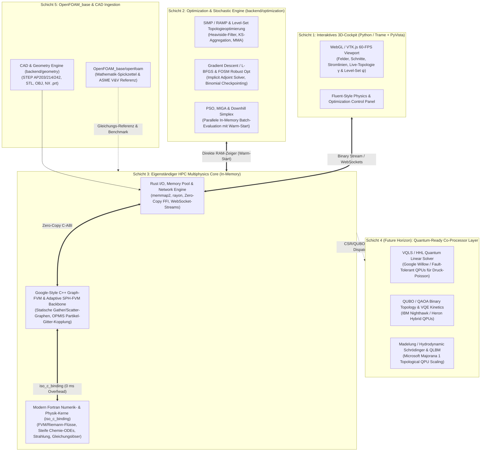

# CFDSolver — Master Architecture & Engineering Blueprint
> **Leitdokument für alle Entwicklungs-, Backend-, Frontend- und Validierungs-Instanzen**  
> **Paradigma:** *Eigenständige, In-Memory „Optimization-First“ Multiphysics Engine (C++ / Modern Fortran / Rust) mit OpenFOAM als mathematischer Blaupause & Validierungs-Referenz sowie Quantum-Ready Erweiterungsschicht.*  
> **Wissenschaftliche Referenzbasis:** Siehe **[resources/papers/literature_survey_2026.md](file:///G:/Datein/Projects/CFDSolver/resources/papers/literature_survey_2026.md)**.

---

## 1. Strategisches Grundprinzip: Eigenständiger Solver statt OpenFOAM-Korsett

Dieses Projekt baut **keinen** bloßen Wrapper um OpenFOAM, sondern einen **eigenständigen, hochperformanten Multiphysics- und Optimierungs-Solver**.

### Warum OpenFOAM nur als Orientierung („Spickzettel“) dient:
1. **Kein Dateisystem-Flaschenhals (Zero-Disk In-Memory Loop):**  
   OpenFOAM erzwingt für jeden Lauf Dateisystem-Operationen (`0/`, `constant/`, `system/`). Bei **Particle Swarm Optimization (PSO)**, **MIGA** oder **Monte-Carlo-Simulationen** mit tausenden Varianten vernichtet dieser I/O-Overhead die Performance. Unsere Engine hält Gitter, Felder und Matrizen **permanent im RAM**.
2. **Volle Differenzierbarkeit für SIMP, Level-Set, FOSM & Gradient Descent:**  
   Für Topologieoptimierung (**SIMP / RAMP / Level-Set**), **Robust Design Optimization (FOSM)** und **Gradient Descent** (über Millionen Zellen) werden exakte Ableitungen ($\frac{\partial J}{\partial \gamma_i}$) mittels *Adjoint-Methoden*, *Implicit Function Theorem* und *Automatic Differentiation (AD)* benötigt. OpenFOAMs tief verschachtelte C++-Makros verhindern dies. Unsere flachen, graph-vektorisierten C++- und Fortran-Rechenkerne sind von Grund auf **100 % AD- und Adjoint-kompatibel**.
3. **Rolle von `OpenFOAM_base/openfoam/` & externen Referenzen (`resources/reference_spickzettel/`):**
   * **Zero-Dependency / Eigener Code statt Bibliotheks-Flickenteppich:**  
     Wir binden **keine** schweren, fremden Black-Box-Bibliotheken ein, die eigene Speicherformate erzwingen oder die automatische Differenzierbarkeit (Adjoint/AD) unterbrechen. Stattdessen nutzen wir `OpenFOAM_base` (insbesondere `src/fused/` und `src/optimisation/adjointOptimisation/`) sowie die Algorithmen aus `SU2`, `SPHinXsys` und `AMGCL` als **reinen Spickzettel ([`resources/reference_spickzettel/INDEX.md`](file:///G:/Datein/Projects/CFDSolver/resources/reference_spickzettel/INDEX.md))** und übersetzen die besten mathematischen Kerne direkt und makrolos in unser eigenes, einheitliches C++/Fortran/Rust-Datenlayout.
   * **Entwicklung in vertikalen Scheiben (Vertical Slicing):**  
     Statt monatelang horizontal 12 ungetestete Module auf Vorrat zu schreiben, wird jede Baustufe als **komplett durchgängige, lauffähige Scheibe** (Geometrie/Octree-Cut-Cell-Mesh $\rightarrow$ Graph-FVM/Fortran-Kern $\rightarrow$ Adjoint/SIMP $\rightarrow$ Live-Cockpit & Benchmark gegen `OpenFOAM_base`) gebaut.
   * **Kreuzvalidierungs-Referenz (ASME V&V 20):** Goldstandard-Vergleichslöser (analog zum Drop-in-Validierungsprinzip aus [`Meshing_FVM_DiFVM_2603.15920v1.pdf`](file:///G:/Datein/Projects/CFDSolver/resources/papers/Meshing_FVM_DiFVM_2603.15920v1.pdf)), um zu beweisen, dass unsere eigene Engine physikalisch identische Ergebnisse liefert – aber um Größenordnungen schneller optimiert.

---

## 2. System-Architektur (5-Schichten-Modell inkl. Quantum-Ready Horizon)

---

## 3. Verbindliche Sprach-Aufteilung & Algorithmische Kern-Patterns

Als Sprach-Referenz dienen die Richtlinien aus [`resources/papers/ProgrammingLanguage/`](file:///G:/Datein/Projects/CFDSolver/resources/papers/ProgrammingLanguage) sowie die Fachpublikationen in [`resources/papers/`](file:///G:/Datein/Projects/CFDSolver/resources/papers):

### A. C++ — Graph-FVM Topologie, Adaptive SPH-FVM & Modul-Steuerung (`backend/native_cpp/`)
* **Verbindlicher Standard:** **Google C++ Style Guide** (kombiniert mit modernem C++20/23).
* **Architektur-Regeln:**
  * **Klare Einfachheit statt Makro-Magie:** Keine kryptischen OpenFOAM-Makros, keine tiefen Vererbungsbäume, keine versteckten Operator-Überladungen, die heimlich Speicher auf dem Heap allokieren.
  * **Statischer Graph-FVM Aufbau (nach *DiFVM*, [`Meshing_FVM_DiFVM_2603.15920v1.pdf`](file:///G:/Datein/Projects/CFDSolver/resources/papers/Meshing_FVM_DiFVM_2603.15920v1.pdf)):**
    * Unstrukturierte Polyeder-/Hexaeder-/Tetraeder-Gitter werden beim Initialisieren in statische, 64-Byte-ausgerichtete *Structure of Arrays (SoA)* Graphen-Arrays überführt: `owner`, `neighbour` $\in \mathbb{Z}^{|\mathcal{E}|}$, Flächenvektoren $\mathbf{S}_f$, Flächenzentren $\mathbf{x}_f$, orthogonale Zerlegung $\boldsymbol{\Delta}_f = \frac{|\mathbf{S}_f|}{|\hat{\mathbf{S}}_f \cdot \hat{\mathbf{d}}_{ij}|}\hat{\mathbf{d}}_{ij}$ und nicht-orthogonale Korrekturvektoren $\mathbf{k}_f = \mathbf{S}_f - \boldsymbol{\Delta}_f$.
    * Alle FVM-Operatoren (Konvektion mit *Deferred Correction* SOU/QUICK, Diffusion mit *Over-Relaxed Correction*, Rhie-Chow-Interpolation und 3-Layer PISO-Projektion) arbeiten als **zweischrittige Gather-Compute-Scatter-Operationen** über die Kantenliste $\mathcal{E}$ und Knotenliste $\mathcal{V}$.
  * **Adaptive SPH-FVM Kopplung für extreme Grenzflächen (nach *Wang et al.* [`MeshingFVM_SPH_2312.03542v1.pdf`](file:///G:/Datein/Projects/CFDSolver/resources/papers/MeshingFVM_SPH_2312.03542v1.pdf) & *Zhang et al.* [`MeshingPaperBubble1-s2.0-S030193222500134X-main.pdf`](file:///G:/Datein/Projects/CFDSolver/resources/papers/MeshingPaperBubble1-s2.0-S030193222500134X-main.pdf)):**
    * Für heftige Mehrphasen-Phänomene (Kavitationsblasen-Kollaps, Strahlaufbruch, Schmelzbad-Ablation) unterstützt der Kern eine mitwandernde SPH-Partikelzone ($P_{com}, P_{trn}, P_{imt}$), die über das **OPMIS-Schema** (Renormierungsmatrix $\mathbf{B}_i$ + lineare Gradientenrekonstruktion) und die **Nullte-Ordnung-Randkonsistenz** ($\mathbf{A}_{iS}^{ESPH} = -\sum_P V_P \nabla W_{iP}$) verlustfrei in das äußere FVM-Gitter ($M_{slp}, M_{imt}, M_{com}$) eingebettet wird.

### B. Modern Fortran (2018/2023) — Dichte Berechnungs- & Physik-Kerne (`backend/native_fortran/`)
* **Verbindlicher Standard:** **Fortran-Lang Best Practices & Intrinsics** (`iso_c_binding`).
* **Architektur-Regeln:**
  * Strikt `implicit none`, `pure` / `elemental` Prozeduren wo möglich, eindeutige Präzision über `real(c_double)` aus `iso_c_binding`.
  * Alle Schnittstellen nach außen tragen `bind(C, name="...")` mit expliziten `contiguous`-Array-Argumenten.
  * Nutzung von garantiert alias-freien Array-Operationen, `do concurrent` und OpenMP-SIMD (`!$omp simd`) für 100 % AVX2/AVX-512 Vektorisierung.
* **Aufgaben:**
  * Vektorisierte Kanten-Flussberechnung ($\mathcal{M}(\mathbf{u}_i, \mathbf{u}_j, \mathbf{g}_{ji})$) inkl. HLLC-Riemann-Löser (mit dissipationsarmem Limiter $\beta_{HLLC}$ aus [`MeshingFVM_SPH_2312.03542v1.pdf`](file:///G:/Datein/Projects/CFDSolver/resources/papers/MeshingFVM_SPH_2312.03542v1.pdf)).
  * Steife Reaktionskinetik (Arrhenius, Cantera/Chemkin-Gleichungen) & analytische Jacobi-Matrizen ($\frac{\partial \mathbf{S}}{\partial \mathbf{U}}$).
  * Thermophysikalische Zustandsgleichungen (NASA-Polynome, Stiffened-Gas EOS für Mehrphasen-Stöße, Transportgrößen).
  * Lineare Gleichungslöser-Kerne (PCG, BiCGStab, GMRES, ILU/AMG-Glätter) und **implizite Adjoint-/Gradienten-Kerne**.

### C. Rust — I/O, Speichermanagement, Netzwerk & Schwarm-Orchestrierung (`backend/native_rust/`)
* **Verbindlicher Standard:** **Rust API Guidelines** ([`Rust API Guidelines.pdf`](file:///G:/Datein/Projects/CFDSolver/resources/papers/ProgrammingLanguage/Rust/Rust%20API%20Guidelines.pdf)).
* **Architektur-Regeln:**
  * Kompilierung als C-kompatible Shared Library (`cdylib` mit `#[no_mangle] pub extern "C"`) sowie Python-Bindings via `PyO3`.
  * Strikte Trennung von sicherem Rust-Code und minimalen `unsafe`-FFI-Blöcken an der C++/Fortran-Grenze.
* **Aufgaben:**
  * **High-Speed File I/O:** Memory-Mapped Lesen und Schreiben (`memmap2`) von großen Gitter- und Felddateien (STEP/STL/OBJ/NX, VTK Unstructured Grids, sowie **Drop-in OpenFOAM `constant/polyMesh/` & `0/` Import/Export** für direkte Kreuzvalidierung).
  * **Netzwerk & Live-Streaming:** Asynchrones Binär-Streaming der 3D-Felder, Residuen und Topologie-Updates im laufenden Betrieb an das Trame-Frontend.
  * **Parallel Batch Runner:** Multithreaded Ausführung (`rayon`) für **PSO (Particle Swarm)**, **MIGA** und **Monte-Carlo**-Simulationen über mehrere CPU-Kerne.

---

## 4. „Optimization-First“ Design: SIMP, Level-Set, FOSM, Adjoint & Schwarm-Verfahren

Damit der Solver bei Optimierungsaufgaben niemals umgebaut werden muss, gelten für **alle** Physik-Module von Anfang an folgende Designgesetze (basiert auf [`thesis_Elisabetta_Chimisso.pdf`](file:///G:/Datein/Projects/CFDSolver/resources/papers/thesis_Elisabetta_Chimisso.pdf), [`ArbitraryFunctionOptimization_s00158-023-03540-w.pdf`](file:///G:/Datein/Projects/CFDSolver/resources/papers/ArbitraryFunctionOptimization_s00158-023-03540-w.pdf), [`Optimization_LevelSetMethod_AIAA-2010-2842-327.pdf`](file:///G:/Datein/Projects/CFDSolver/resources/papers/Optimization_LevelSetMethod_AIAA-2010-2842-327.pdf) und [`optimization-curved-fir-tree-turbine-15.pdf`](file:///G:/Datein/Projects/CFDSolver/resources/papers/optimization-curved-fir-tree-turbine-15.pdf)):

### 1. Eingebautes SIMP/RAMP-Designfeld $\gamma_i \in [0, 1]$ + Heaviside-Filter + Level-Set $\psi_i$
Jede Zelle $i$ besitzt neben Druck $p$, Geschwindigkeit $\mathbf{u}$ und Temperatur $T$ standardmäßig die kontinuierliche Designvariable $\gamma_i \in [0, 1]$ (*Pseudo-Dichte*):
* $\gamma_i = 1$: Reines Fluid (ungehinderte Strömung).
* $\gamma_i = 0$: Reiner Festkörper (Wand / Struktur).
* **Filter- & Projektionskette gegen Schachbrettmuster & Graustufen:**
  $$\gamma_i \xrightarrow{\text{Helmholtz/Nachbarschaftsfilter}} \tilde{\gamma}_i \xrightarrow{\text{Heaviside-Projektion}} \bar{\gamma}_i = \frac{\tanh(\beta \eta) + \tanh(\beta(\tilde{\gamma}_i - \eta))}{\tanh(\beta \eta) + \tanh(\beta(1 - \eta))}$$
* **Brinkman-Penalisierung & RAMP-Interpolation (nicht-verschwindende Ableitung bei $\bar{\gamma}_i = 0$):**
  $$\rho (\mathbf{u} \cdot \nabla)\mathbf{u} = -\nabla p + \nabla \cdot (\mu \nabla \mathbf{u}) - \alpha(\bar{\gamma}_i)\,\mathbf{u}, \quad \alpha(\bar{\gamma}_i) = \alpha_{\max} \frac{q (1 - \bar{\gamma}_i)}{q + \bar{\gamma}_i}$$
  $$\lambda(\bar{\gamma}_i) = \lambda_{\min} + (\lambda_0 - \lambda_{\min}) \frac{\bar{\gamma}_i}{1 + p(1 - \bar{\gamma}_i)}$$
* **Optionale Level-Set-Konturschärfung (nach *James & Martins*):**
  Über eine auf dem Gitter definierte Level-Set-Funktion $\psi(\mathbf{x})$ (Hamilton-Jacobi-Update $\frac{\partial_T \psi}{\partial t} + V_T |\nabla_T \psi| = 0$ mittels Jacobi-Transformation $\mathbf{J}(\xi,\eta,\zeta)$ und Fast-Sweeping Eikonal-Reinitialisierung $|\nabla \psi| = 1$) lassen sich optimierte SIMP-Topologien ohne Neuvernetzung in glatte, fertigungsgerechte CAD-Oberflächen ($\psi = 0$) überführen.

### 2. Implizite Differenzierbarkeit, Binomial Checkpointing & KS-Aggregation
* **Impliziter Druck-Adjoint (nach *DiFVM*, Gl. 25):**  
  Der iterative Druck-Poisson-Löser $\mathcal{F}(p^*, \mathbf{u}^*) = 0$ wird im Rückwärtspass **nicht** ausgerollt, sondern über das implizite Funktionentheorem mit demselben linearen Löser (CG/AMG) in einem einzigen Schritt adjungiert gelöst:
  $$\left(\frac{\partial \mathcal{F}}{\partial p^*}\right)^T \boldsymbol{\lambda}_p = \left(\frac{\partial \mathcal{L}}{\partial p^*}\right)^T$$
* **Binomial Gradient Checkpointing:**  
  Bei instationären Optimierungen werden nur $\mathcal{O}(\sqrt{n_{\text{steps}}})$ Zeitschritte im RAM gesichert und Zwischenzustände bei Bedarf nachberechnet.
* **Kreisselmeier-Steinhauser (KS) Aggregation für lokale Spitzenwerte (nach *Kranz et al.*, Gl. 27):**  
  Nicht-differenzierbare Ziel- oder Nebenbedingungen wie maximale Bauteiltemperatur $\max_i(T_i)$ oder maximale Vergleichsspannung $\max_i(\sigma_{\text{VM},i})$ werden über die glatte KS-Funktion differenzierbar gemacht:
  $$q^{KS} = q_{\max} + \frac{1}{\gamma_{KS}} \ln \left[ \sum_{i=1}^{N_c} \exp\left(\gamma_{KS}(q_i - q_{\max})\right) \right]$$

### 3. Robuste Optimierung unter Unsicherheiten (Generalisierte FOSM statt Monte-Carlo-Zwang)
* Um Geometrie-, Randbedingungs- oder Materialunsicherheiten $\boldsymbol{\alpha} \sim (\boldsymbol{\mu}_{\alpha}, \boldsymbol{\Sigma}_{\alpha})$ direkt während der Topologieoptimierung zu berücksichtigen ($\Phi_g = \mu_g + \kappa \sigma_g$), implementiert `backend/optimization/` die **Generalisierte FOSM-Methode** ([`ArbitraryFunctionOptimization_s00158-023-03540-w.pdf`](file:///G:/Datein/Projects/CFDSolver/resources/papers/ArbitraryFunctionOptimization_s00158-023-03540-w.pdf)):
  $$\sigma_g^2 \approx \left(\frac{\partial g}{\partial \boldsymbol{\alpha}} - \boldsymbol{\lambda}_g^T \frac{\partial \mathbf{R}}{\partial \boldsymbol{\alpha}}\right)^T \boldsymbol{\Sigma}_{\alpha} \left(\frac{\partial g}{\partial \boldsymbol{\alpha}} - \boldsymbol{\lambda}_g^T \frac{\partial \mathbf{R}}{\partial \boldsymbol{\alpha}}\right)$$
* Damit kostet eine komplette robuste Topologieoptimierung **weniger als 3 zusätzliche Adjoint-Lösungen pro Iteration** (statt 1.000+ Monte-Carlo-Läufen), wobei Monte Carlo anschließend zur finalen Verifikation genutzt wird.

### 4. Zweistufige Globale + Lokale Suche mit In-Memory Warm-Start
* Für niedrig- bis mitteldimensionale Parameter- und Formoptimierungen (wie in [`optimization-curved-fir-tree-turbine-15.pdf`](file:///G:/Datein/Projects/CFDSolver/resources/papers/optimization-curved-fir-tree-turbine-15.pdf)) kombiniert die Engine:
  1. **Globale Exploration:** **PSO (Particle Swarm Optimization)** & **MIGA (Multi-Island Genetic Algorithm)** mit Sub-Populationen und periodischer Migration, parallelisiert über Rust `rayon`.
  2. **Schnelle lokale Verfeinerung:** **Downhill Simplex (Nelder-Mead)** (ableitungsfrei) bzw. **L-BFGS / MMA** (gradientenbasiert).
* **In-Memory Warm-Start:** Über `reset_and_update_parameters(params_ptr)` starten benachbarte Varianten direkt auf dem konvergierten Feld des Vorgängers (60–80 % weniger Iterationen).

---

## 5. Die 12 Physik-Module in der eigenständigen Architektur

Alle 12 Module werden als saubere C++/Fortran-Kernel-Paare implementiert, wobei `OpenFOAM_base` als mathematische Vorlage dient:

1. **Energy & Conjugate Heat Transfer (CHT)**
2. **Viscous & Turbulence** ($k-\omega$ SST, Spalart-Allmaras, LES WALE)
3. **Multiphase** (VOF, Euler-Euler, Kavitation + **Adaptive SPH-FVM OPMIS-Kopplung**)
4. **Species & Chemistry** (Beliebige Reaktionskinetik, Cantera/Chemkin, Washcoat-Katalyse)
5. **Discrete Phase (DPM)** (Lagrange-Partikel, Spray-Breakup, Bai-Gosman Wandstoß)
6. **Eulerian Wall Film (EWF)** (2D-Wandfilme, Verdampfung/Kondensation)
7. **Radiation** (fvDOM Diskrete Ordinaten, P1)
8. **Acoustics** (Ffowcs Williams-Hawkings FWH, Curle)
9. **Ablation & TPS** (Oberflächenrezession, Pyrolyse, Darcy-Brinkman-Stokes)
10. **Battery Simulation** (Elektrochemisch-thermisches 2-RC ECM & Thermal Runaway)
11. **Magnetohydrodynamics (MHD)** (Lorentz-Kraft $\mathbf{J} \times \mathbf{B}$, Potentialgleichung)
12. **Porous Media & Heat Exchanger** (Darcy-Forchheimer, direkt gekoppelt mit dem SIMP-Feld $\gamma_i$)

---

## 6. Hardware-Abstraktion nach Präzisions-Klassen (Precision-Tier & Add-on Prinzip)

Der Solver wird **niemals hart auf einen bestimmten Chip-Hersteller programmiert**, sondern orientiert sich dynamisch an den **Fließkomma-Präzisionsklassen (`FP64`, `FP32`, `FP16`/`BF16`)**, die das jeweilige System zur Laufzeit bereitstellt:

### 1. Tier 1 — Verbindliche `FP64`-Basis (Immer vorhanden: Standard-CPU & optionale HPC-GPUs)
* **Jede moderne Standard-CPU (x86-64 Intel/AMD via AVX2/AVX-512 sowie ARM64) beherrscht natives Hardware-`FP64` (64-Bit IEEE-754 Double Precision) in voller Geschwindigkeit.**
* **Grundgesetz:** Der gesamte C++/Fortran/Rust-Solver läuft **immer zu 100 % eigenständig auf einer reinen Standard-CPU in `FP64`**, ohne dass eine spezielle GPU oder ein Cloud-Beschleuniger vorhanden sein muss.
* Alle Erhaltungsgleichungen (Masse, Impuls, Energie), Grenzschicht-Flüsse ($y^+ < 1$), steife Reaktionskinetik (`species_chem`) und äußeren Residuen ($\mathbf{r}_{\text{FP64}} = \mathbf{b} - \mathbf{A}\mathbf{p}$) werden zwingend in `FP64` ausgewertet.
* Wenn ein vollwertiger `FP64`-HPC-Beschleuniger im System steckt (z. B. **AMD Instinct MI300X / MI430X** mit HBM-Speicher), kann Tier 1 nahtlos darauf ausgelagert werden.

### 2. Tier 2 — Optionales `FP16` / `BF16` / `FP32` Booster-Add-on (Consumer-GPUs, NPUs, TPUs & KI-ASICs)
Viele Systeme (normale Gaming-/Workstation-GPUs wie GeForce RTX / Radeon, integrierte NPUs oder Cloud-Transformer-ASICs wie Google TPU) besitzen extrem schnelle `FP16`/`BF16`/`FP32`-Einheiten, aber kein (oder nur stark gedrosseltes) `FP64`.
* **Modulares Add-on-Prinzip (`PrecisionAddon::LowPrecisionBooster`):**  
  Wenn das System solche `FP16`/`BF16`/`FP32`-Einheiten bereitstellt, werden sie **optional als reiner Vorberechnungs- & Beschleunigungs-Booster** zugeschaltet – ohne die `FP64`-Physik zu verfälschen:
  1. **Turbo-Initialisierung via `FP16`/`BF16`-Interpolationsfeld (`FieldInitializerAddon`):**  
     Vor dem eigentlichen `FP64`-Lauf erzeugt das `FP16`/`BF16`-Add-on (per schneller Grob-Iteration, Mehrgitter-Interpolation oder GNN/FNO-Surrogat) in wenigen Millisekunden ein hochgenaues Startfeld $(\mathbf{u}_{\text{init}}, p_{\text{init}}, T_{\text{init}})$ und konvertiert es per **Upcast (`FP16` $\rightarrow$ `FP64`)** in den Hauptspeicher. Der `FP64`-Hauptsolver spart dadurch 70–90 % der Einlauf-Iterationen, behält aber 100 % `FP64`-Endgenauigkeit.
  2. **Mixed-Precision Iterative Refinement (`InnerPreconditionerAddon`):**  
     Beim Lösen der Druck-Poisson-Matrix wird das äußere Residuum $\mathbf{r}_{\text{FP64}} = \mathbf{b} - \mathbf{A}\mathbf{p}^{(k)}$ strikt in `FP64` auf der CPU/HPC-Einheit berechnet, auf `FP16`/`FP32` heruntergecastet (`Downcast`), die grobe Korrektur $\mathbf{A}_{\text{low}} \Delta \mathbf{p}_{\text{low}} \approx \mathbf{r}_{\text{low}}$ auf dem schnellen Add-on gelöst und als `FP64`-Update $\mathbf{p}^{(k+1)} = \mathbf{p}^{(k)} + \text{Upcast}(\Delta \mathbf{p}_{\text{low}})$ zurückgegeben.
### 3. System-Check, Auto-Tuner (`hardware_profile.json`) & Vendor-Dispatch
Beim ersten Start (oder auf Knopfdruck im Cockpit) führt das System-Modul `backend/core/hardware_discovery` einen **automatischen Hardware-Check & 5-Sekunden-Mikrobenchmark** durch:
* **Erkennung der System-Topologie:**
  * Befehlssatz (x86-64 AVX2/AVX-512, ARM64 NEON/SVE, RISC-V RVV), L1/L2/L3-Cachegrößen pro Kern, Hybrid-Topologie (Intel P-Cores vs. E-Cores, AMD CCDs, NUMA-Knoten) sowie optionale GPUs/NPUs/ASICs.
* **Auto-Tuning & Hersteller-Weiche (Vendor Dispatch):**
  * Bestimmt die optimale Cache-Blockgröße (`TILE_SIZE`) für das *Cuthill-McKee / Morton Space-Filling Curve* Gitter-Layout und speichert sie in `hardware_profile.json`.
  * Lädt dynamisch das schnellste verfügbare Mathe-Backend des erkannten Herstellers (z. B. **Intel oneAPI MKL** auf Intel-CPUs, **AMD AOCL / ROCm** auf AMD, **NVIDIA AmgX / cuSPARSE** auf GeForce/HPC-GPUs, **Apple Accelerate / ARMPL** auf ARM64) mit automatischem Fallback auf unseren eigenen Fortran/C++-Standardkern.

### 4. Automatisches Redistributing & Dynamic Load Balancing (`DynamicRedistributor`)
In Multiphysics- und Optimierungsläufen verschiebt sich die Rechenlast ständig (z. B. wandernde Flammen-/Zündfronten in `species_chem`, wachsende SPH-Blasen in `multiphase`, SIMP-Zellen die von Fluid $\gamma_i=1$ zu Festkörper $\gamma_i=0$ werden, oder wenn Windows im Hintergrund einen P-Core belastet).  
Da unser Solver alle Felder als flache Arrays **im gemeinsamen RAM** hält, entfällt das langsame Dateisystem-Neuschreiben klassischer Solver (`redistributePar`):

1. **Echtzeit-Telemetrie pro Partition:**
   * Jede Partition $p$ misst in jedem Zeitschritt ihre tatsächliche Rechenzeit $t_p$ sowie die zellweise Kostenverteilung $w_i$ (z. B. Anzahl benötigter Chemie-Substeps oder SPH-Nachbarn).
   * Überschreitet der **Imbalance-Faktor** den Schwellenwert
     $$I = \frac{\max_p(t_p)}{\overline{t}_p} > 1{,}08 \quad (> 8\,\% \text{ Last-Ungleichgewicht}),$$
     wird automatisch das **Dynamic Redistributing** ausgelöst.
2. **Stufe A — Sofortiges Lock-Free Work-Stealing (innerhalb desselben Zeitschritts, $< 5\,\mu\text{s}$):**
   * Für zelllokale Schwerstarbeit (steife Reaktionskinetik-ODEs, EOS, Strahlungs-Richtungen, DPM/SPH-Partikel) greifen fertig gewordene Kerne über eine *Work-Stealing-Queue* (`rayon` / C++ Task-Pool) sofort auf die verbleibenden Gitter-Tiles überlasteter Partitionen zu.
3. **Stufe B — Zero-Copy Partitionsgrenzen-Verschiebung (Space-Filling Curve Shifting, $0\text{ ms}$ Kopier-Overhead):**
   * Da die Gitterzellen entlang einer raumfüllenden Kurve (**Morton / Hilbert / Reverse Cuthill-McKee**) im RAM sortiert sind, werden bei einem Ungleichgewicht einfach die Partitions-Start-/End-Zeiger (`partition_range[p] = [start_i, end_i)`) anhand der gemessenen Zellgewichte $w_i$ neu berechnet:
     $$\sum_{i = \text{start}_p}^{\text{end}_p - 1} w_i \approx \frac{\text{CoreSpeed}_p}{\sum_k \text{CoreSpeed}_k} \sum_{i=1}^{N_c} w_i$$
   * **Der Clou:** Es muss **kein einziges Datenbyte im RAM umkopiert werden** – die überlastete Partition gibt einfach ihre Rand-Blöcke (Tiles) per Zeiger-Verschiebung an den schnelleren Nachbarkern ab!

---

## 7. Quantum-Ready Horizon: Optionale Schnittstellen für QPU-Ko-Prozessoren

Aufbauend auf der mikroskopischen Quanten-Gas-Kinetik und der **Madelung-Isomorphie** ($\psi(\mathbf{x},t) = \sqrt{\rho}\,e^{iS/\hbar}$) definiert die Architektur drei standardisierte Plug-in-Schnittstellen (`backend/optimization/quantum_bridge/`), um zukünftige Quanten-Ko-Prozessoren (QPUs) als optionale Add-ons einzubinden:

1. **`LinearSolverBackend::QuantumVQLS_HHL` (Fehlertolerante Gate-QPUs, z. B. *Google Willow & Nachfolger*):**
   * Exportiert den symmetrisch positiv-definiten Graph-Laplacian der Druck-Poisson-Gleichung ($\mathbf{A}\mathbf{p} = \mathbf{b}$) als dünnbesetztes Block-Encoding für Variational Quantum Linear Solvers (VQLS) bzw. HHL-Algorithmen ($\mathcal{O}(\text{polylog}(N_c))$ Skalierung).
2. **`TopologyOptimizer::QuantumQUBO_QAOA` (Hybride Supraleiter-/Annealing-QPUs, z. B. *IBM Nighthawk / Heron*):**
   * Formuliert diskrete $0/1$-Materialverteilungs- und Kanalnetzwerk-Probleme als quadratisches binäres Optimierungsproblem ($\min_{\boldsymbol{\gamma} \in \{0,1\}^N} \boldsymbol{\gamma}^T \mathbf{Q} \boldsymbol{\gamma}$) für QAOA und Quantum Annealing, sowie VQE-Schnittstellen für Ab-initio-Reaktionsbarrieren ($E_a$).
3. **`QuantumFluidKernel::Madelung_QLBM` (Skalierbare topologische QPUs, z. B. *Microsoft Majorana 1*):**
   * Experimenteller Rechenkern für die **Hydrodynamic Schrödinger Equation (Madelung-Fluss)** und **Quantum Lattice Boltzmann (QLBM)** / Carleman-Linearisierung zur unitären Quantensimulation von Wirbel- und Mehrphasenströmungen.
