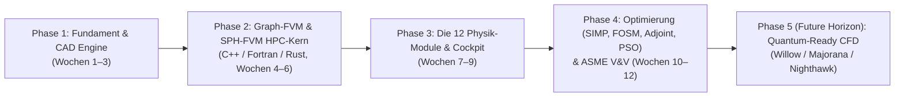

# CFDSolver Platform — Master Roadmap
> **Strategische Ausrichtung:** Aufbau eines **eigenständigen, In-Memory Multiphysics- und Optimierungs-Solvers** (C++ / Modern Fortran / Rust), bei dem OpenFOAM als mathematische Orientierung & Validierungs-Referenz dient.  
> **Architektur-Vorgabe:** Siehe **[ARCHITECTURE.md](file:///G:/Datein/Projects/CFDSolver/ARCHITECTURE.md)** & **[literature_survey_2026.md](file:///G:/Datein/Projects/CFDSolver/resources/papers/literature_survey_2026.md)**.

---

## Phasen-Übersicht

---

## Phase 1: Fundament, CAD-Ingestion & Architektur-Leitplanken (Wochen 1–3)

* [x] **WSL2 & OpenFOAM-Referenzbasis (`OpenFOAM_base/openfoam`):**
  * Sauberes Klonen der OpenFOAM-Quellen als mathematisches Nachschlagewerk („Spickzettel“) und Benchmark-Referenz.
* [x] **CAD & Geometry Ingestion Engine (`backend/geometry/`):**
  * Unterstützung für ISO STEP (AP203/214/242), Binary/ASCII STL, Wavefront OBJ und native Siemens NX `.prt`-Dateien.
  * Vollständiger Topologie- und Qualitäts-Auditor (2-Manifold, Euler $\chi=2$, Normalen, 10/10 `surfaceCheck`-Kriterien, 272/272 Tests bestanden).
* [x] **Architektur-, Sprach- & Literatur-Vertrag (`ARCHITECTURE.md` & `resources/papers/`):**
  * Festlegung auf **Google C++ Style Guide** (Graph-FVM & SoA-Datenstrukturen), **Modern Fortran** (`iso_c_binding` Rechenkerne) und **Rust** (In-Memory-Pool, I/O & Network).
  * Integration der 7 Schlüsselpublikationen zu Graph-FVM (*DiFVM*), Eulerian/Adaptive SPH-FVM (*Wang et al.*, *Zhang et al.*), Thermo-Fluid SIMP (*Chimisso*), Robust FOSM Optimization (*Kranz et al.*), Level-Set (*James & Martins*) und MIGA/Simplex (*Tan et al.*).
* [ ] **Frontend Grundgerüst (`frontend/cockpit/`):**
  * Trame + PyVista 3D-Viewport (WebGL 60 FPS) mit CAD-Import, Gitter-Vorschau und Fluent-Style „Models Panel“.

---

## Phase 2: Eigenständiger In-Memory Graph-FVM, Next-Gen Mesher & SPH-FVM HPC-Kern (Wochen 4–6)

* [ ] **Produktionsreifer In-Memory Mesher, Poly-Hexcore & `polyMesh`-Cross-Validation (`backend/meshing/`):**
  * Vollständige Sanierung der Audit-Befunde (`K1`–`K8`, `Bug A`–`Bug F`, `H1`–`H11` gemäß [`SUGGESTIONS_BACKEND.md`](file:///G:/Datein/Projects/CFDSolver/SUGGESTIONS_BACKEND.md)): explizite `faces`-Konnektivität + `constant/polyMesh`-Exporter für `checkMesh`-Kreuzvalidierung, echte 3D-Fluidgebiets-Extraktion (`external_fluid` Farfield-Box & `internal_fluid` Floodfill), B-Rep Patch-Vererbung, Generalized Winding Numbers / Pseudonormalen-SDF (`libigl`/`fTetWild`), kollisionsfreie Medial-Axis-Grenzschichtextrusion mit Kernnetz-Stitching sowie Hilbert/Morton Space-Filling-Curve-Ordering.
  * Ausbau zu **Mosaic-artigem Poly-Hexcore / VoroCrust** (Octree-Hexaeder-Kern + Poly-Prismen-Wand + konvexe Polyeder-Übergangsschicht / Small-Cut-Cell Merging & WSRD), **polykonvexer Neo-Hooke-ALE** und gekoppeltem **2D-`faMesh`-Submesh** für Wandfilme.
* [ ] **C++ Unstructured Graph-FVM Backbone & `MeshErrorMap` (`backend/native_cpp/`):**
  * Statische *Structure of Arrays (SoA)* Graph-Repräsentation nach *DiFVM* ([`Meshing_FVM_DiFVM_2603.15920v1.pdf`](file:///G:/Datein/Projects/CFDSolver/resources/papers/Meshing_FVM_DiFVM_2603.15920v1.pdf)): `owner`, `neighbour`, Flächenvektoren $\mathbf{S}_f$, orthogonale Zerlegung $\boldsymbol{\Delta}_f$, nicht-orthogonale Korrektur $\mathbf{k}_f$, Volumina $V_i$ und Zell-Designfeld $\gamma_i \in [0, 1]$.
  * **Vorberechnete Geometrische Fehlerkompensations- & Stabilisierungs-Map (`MeshErrorMap` nach dem CMS-Prinzip):** Einmalig im Mesher erzeugte Qualitäts- & Kompensationsfelder (Skewness-Versatzvektor $\mathbf{m}_f^{\text{skew}}$, gedeckeltes $\mathbf{k}_f^{\text{comp}}$, verzweigungsfreies Upwind-Blending $\beta_f \in [0, 1]$ und zellweise Diagonal-Stabilisierung $\omega_i \in (0, 1]$ für Multiphysics/Adjoint).
  * Zweischrittige, 100 % vektorisierte **Gather-Compute-Scatter**-Operatoren für Konvektion (*Deferred Correction* SOU/QUICK), Diffusion (*Over-Relaxed Correction*), Rhie-Chow-Interpolation und 3-Layer PISO-Projektion.
* [ ] **Adaptive SPH-FVM Hybrid-Kopplung (`backend/native_cpp/sph_fvm/`):**
  * Konsistenter Eulerian-SPH Randalgorithmus (Nullte-Ordnung-Konsistenz $\mathbf{A}_{iS}^{ESPH} = -\sum_P V_P \nabla W_{iP}$ nach *Wang et al.* [`MeshingFVM_SPH_2312.03542v1.pdf`](file:///G:/Datein/Projects/CFDSolver/resources/papers/MeshingFVM_SPH_2312.03542v1.pdf)).
  * Mitwandernde SPH-Partikelzone ($P_{com}, P_{trn}, P_{imt}$) mit **OPMIS-Interpolation** (Renormierungsmatrix $\mathbf{B}_i$ nach *Zhang et al.* [`MeshingPaperBubble1-s2.0-S030193222500134X-main.pdf`](file:///G:/Datein/Projects/CFDSolver/resources/papers/MeshingPaperBubble1-s2.0-S030193222500134X-main.pdf)) für heftige Mehrphasen-Grenzflächen.
* [ ] **Modern Fortran Numerik- & Gleichungskerne (`backend/native_fortran/`):**
  * Implementierung der vektorisierten FVM- & HLLC-Riemann-Flüsse (inkl. Limiter $\beta_{HLLC}$), Gauss-Green-Gradienten und linearen Gleichungslöser (PCG, BiCGStab, GMRES mit ILU/AMG) via `iso_c_binding` in striktem `FP64` (Standard-CPU-Baseline).
  * Vektorisierte Kinetik-, Thermophysik- und analytische Jacobi-Matrix-Kerne (`!$omp simd` / `do concurrent`).
* [ ] **Optionales Precision-Tier Add-on, Auto-Tuner & Dynamic Redistributing:**
  * **System-Check & Auto-Tuner (`hardware_profile.json`):** Automatische Erkennung von Befehlssatz (x86 AVX2/AVX-512, ARM64 NEON/SVE, RISC-V RVV), L1/L2/L3-Cachegrößen, P-/E-Core-Topologie, Hersteller-Mathe-Backends (Intel oneMKL, AMD AOCL/ROCm, NVIDIA AmgX) und Präzisionsklassen (`FP64`-Basis + optionaler `FP16`/`BF16`-Initialisierer).
  * **Automatisches Redistributing (`DynamicRedistributor`):** Echtzeit-Messung des Imbalance-Faktors ($I = \max(t_p)/\overline{t}_p$) mit sofortigem Lock-Free Work-Stealing (für steife Chemie/SPH/DPM) und **Zero-Copy Partitionsgrenzen-Verschiebung** entlang der Space-Filling Curve ohne RAM-Umkopieren.
* [ ] **Rust High-Speed I/O, Drop-In OpenFOAM Interface & Streaming (`backend/native_rust/`):**
  * Memory-Mapped Mesh- & Feld-Loader (`memmap2` + `rayon`) inkl. **Drop-in OpenFOAM Case Reader** (`constant/polyMesh/`, `0/`) und VTK-Schnittstelle.
  * Live-Binär-Streaming der Felder und Residuen aus dem RAM direkt an das Trame-Cockpit.
* [ ] **Dreikampf-Benchmark (C++ vs. Fortran vs. OpenFOAM):**
  * Messung der Durchsatzrate (Millionen Zellen/Sekunde) und Nachweis des Zero-Copy FFI-Vorteils.

---

## Phase 3: Ausbau der 12 Multiphysik-Module & 3D-Cockpit (Wochen 7–9)

*(Mathematische Gleichungen adaptiert aus `OpenFOAM_base` und [`literature_survey_2026.md`](file:///G:/Datein/Projects/CFDSolver/resources/papers/literature_survey_2026.md), implementiert als saubere C++/Fortran-Module)*

* [ ] **Cluster A — Thermal, Flow & Reactions:**
  * **Energy & CHT:** Sensible/totale Enthalpie, gekoppelte Fluid-Festkörper-Wärmeleitung.
  * **Viscous & Turbulence:** Laminar, RANS ($k-\omega$ SST, Spalart-Allmaras), LES (WALE).
  * **Species & Chemistry:** Allgemeine Mehrspezies-Reaktionskinetik (Arrhenius / Cantera-kompatibel) & heterogene Wandkatalyse.
  * **Radiation & Porous Media:** Diskrete Ordinaten (`fvDOM`), P1, Darcy-Forchheimer.
* [ ] **Cluster B — Multiphase, Particles & Films:**
  * **Multiphase:** Volume of Fluid (VOF), Euler-Euler Zweiphasenströmung, Kavitation & **Adaptive SPH-FVM Blasen-/Strahldynamik (OPMIS)**.
  * **Discrete Phase (DPM):** Lagrange-Partikeltracking, Spray-Breakup, Bai-Gosman Wandkollision.
  * **Eulerian Wall Film (EWF):** 2D-Wandfilmdynamik, Verdampfung & Kondensation.
* [ ] **Cluster C — Advanced Multi-Physics:**
  * **Acoustics:** Ffowcs Williams-Hawkings (FWH) & Curle Schallquellen.
  * **Ablation & TPS:** Reaktive Wandabtragung & Pyrolyse.
  * **Battery Thermal:** Elektrochemisch-thermisches 2-RC Equivalent Circuit Model & Thermal Runaway.
  * **Magnetohydrodynamics (MHD):** Lorentz-Kraft ($\mathbf{J} \times \mathbf{B}$) & induzierte Felder.

---

## Phase 4: Optimierungs-Engine (SIMP, Level-Set, FOSM, Adjoint, PSO) & ASME V&V 20 (Wochen 10–12)

* [ ] **SIMP / RAMP & Level-Set Thermo-Fluid Topologieoptimierung (`backend/optimization/simp/`):**
  * Kontinuierliches Designfeld $\gamma_i \in [0, 1]$ mit Helmholtz-Filterung ($\tilde{\gamma}_i$), Heaviside-Projektion ($\bar{\gamma}_i$), Brinkman-Bestrafung $-\alpha(\bar{\gamma}_i)\mathbf{u}$ und RAMP-Interpolation $\lambda(\bar{\gamma}_i)$ (nach *Chimisso* & *Kranz et al.*).
  * **Level-Set-Konturschärfung** via Jacobi-transformierter Hamilton-Jacobi-Gleichung ($\frac{\partial_T \psi}{\partial t} + V_T |\nabla_T \psi| = 0$) und Fast-Sweeping Eikonal-Reinitialisierung (nach *James & Martins*).
  * **Kreisselmeier-Steinhauser (KS) Aggregation** ($q^{KS}$) für glatt differenzierbare Maximal-Temperatur- und Maximal-Spannungs-Ziele.
* [ ] **Impliziter Adjoint, Binomial Checkpointing & FOSM Robust Optimization (`backend/optimization/gradient/`):**
  * Exakter Druck-Poisson-Adjoint über das **Implicit Function Theorem** ($\left(\frac{\partial \mathcal{F}}{\partial p^*}\right)^T \boldsymbol{\lambda}_p = \left(\frac{\partial \mathcal{L}}{\partial p^*}\right)^T$) und **Binomial Gradient Checkpointing** ($\mathcal{O}(\sqrt{n_{\text{steps}}})$ RAM) für Gradient Descent, L-BFGS und MMA.
  * **Generalisierte FOSM-Methode (First-Order Second-Moment)** für robuste Topologieoptimierung unter Unsicherheiten ($\Phi_g = \mu_g + \kappa \sigma_g$) mit maximal 2–3 zusätzlichen Adjoint-Lösungen statt tausender Monte-Carlo-Samples.
* [ ] **Zweistufige Globale + Lokale Suche mit Warm-Start (`backend/optimization/swarm/`):**
  * Globale Exploration via **PSO (Particle Swarm)** und **MIGA (Multi-Island Genetic Algorithm)**, gekoppelt mit schneller lokaler Verfeinerung via **Downhill Simplex (Nelder-Mead)** / **L-BFGS** und In-Memory Warm-Start.
* [ ] **ASME V&V 20 Kreuzvalidierung gegen OpenFOAM:**
  * 3-Gitter-Richardson-Extrapolation ($GCI$) und direkter Genauigkeits- & Geschwindigkeitsvergleich gegen `OpenFOAM_base` (mittels Drop-in Case-Kompatibilität).

---

## Phase 5 (Future Horizon): Quantum-Ready CFD & QPU Co-Processing (Willow / Majorana / Nighthawk)

* [ ] **Quantum-Ready Linear Solver Bridge (`LinearSolverBackend::QuantumVQLS_HHL`):**
  * Block-Encoding-Export des symmetrischen FVM-Graph-Laplacians ($\mathbf{A}\mathbf{p} = \mathbf{b}$) für **Variational Quantum Linear Solvers (VQLS)** und **HHL** auf fehlertoleranten Surface-Code-QPUs (*Google Willow & Nachfolger*).
* [ ] **QUBO / QAOA Binary Topology & VQE Kinetics (`TopologyOptimizer::QuantumQUBO_QAOA`):**
  * Formulierung diskreter $0/1$-Topologieoptimierungen als **QUBO** ($\min_{\boldsymbol{\gamma} \in \{0,1\}^N} \boldsymbol{\gamma}^T \mathbf{Q} \boldsymbol{\gamma}$) für **QAOA** sowie **VQE**-Anbindung für quantenchemische Aktivierungsbarrieren ($E_a$) auf hybriden Supraleiter-QPUs (*IBM Nighthawk / Heron*).
* [ ] **Madelung-Fluss & Quantum Lattice Boltzmann (`backend/physics_modules/quantum_fluid/`):**
  * Experimentelles Forschungsmodul für die **Madelung-Transformation / Hydrodynamic Schrödinger Equation** ($\psi = \sqrt{\rho}\,e^{iS/\hbar}$) und **Quantum Lattice Boltzmann (QLBM)** / Carleman-Linearisierung im Hinblick auf skalierbare topologische QPUs (*Microsoft Majorana 1*).
