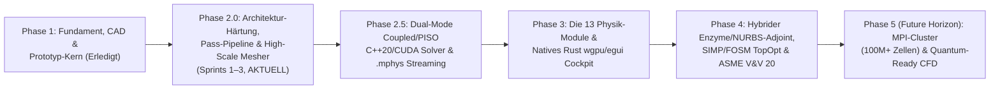

# CFDSolver / MultiphysicsSolver Platform — Master Roadmap

> **Strategische Ausrichtung:** Aufbau eines **eigenständigen, hochskalierenden In-Memory Multiphysics-, Vernetzungs- und Optimierungs-Stacks** (**C++20 / CUDA** für Mesher, gekoppelte FVM- & SPH-FVM-Kerne, **Rust** für `.mphys`-Zero-Copy-I/O, SPMC-Streaming & `wgpu + egui`-Cockpit, **Python** für Orchestrierung, CAD-Pipeline & Plugin-Specs), bei dem OpenFOAM als mathematische Orientierung & Drop-in-Validierungsreferenz dient.  
> **Normative Dokumente:** **[`AGENTS.md`](AGENTS.md)** · **[`INVARIANTS.md`](INVARIANTS.md)** · **[`CONTRACTS.md`](CONTRACTS.md)** · **[`ARCHITECTURE.md`](ARCHITECTURE.md)** · **[`SUGGESTIONS_BACKEND.md`](SUGGESTIONS_BACKEND.md)** · **[`literature_survey_2026.md`](resources/papers/literature_survey_2026.md)** · **[`docs/BLUEPRINT_AND_AUDIT_SUMMARY.md`](docs/BLUEPRINT_AND_AUDIT_SUMMARY.md)**

---

## Phasen-Übersicht

---

## Phase 1: Fundament, CAD-Ingestion & Literatur-/Spickzettel-Synthese (Abgeschlossen)

* [x] **WSL2 & OpenFOAM-Referenzbasis (`OpenFOAM_base/openfoam`):**
  * Lokale Referenzquellen für FVM-Operatoren, Randbedingungen und `checkMesh`-Kreuzvalidierung.
* [x] **CAD & Geometry Ingestion Engine (`backend/geometry/`):**
  * Unterstützung für ISO-10303 STEP (AP203/214/242 via Gmsh/OCCT & B-Rep-Parser), Binary/ASCII STL, Wavefront OBJ und Siemens NX `.prt`.
  * Vollständiger Oberflächen- & Topologie-Auditor (Wasserdichtheit, 2-Manifold, Euler-Charakteristik, Normalenorientierung) sowie Ganzdatei-Einheitenerkennung (`mm`, `cm`, `m`, `in`) mit `OCCTargetUnit`-Kopplung und Dreiecksbudget-Guard (`AUD-005`).
* [x] **Wissenschaftliches & Algorithmisches Fundament ([`literature_survey_2026.md`](resources/papers/literature_survey_2026.md) & [`INDEX.md`](resources/reference_spickzettel/INDEX.md)):**
  * Vollständige mathematische Auswertung von 23 Spezialkapiteln + struktur-erhaltenden Operatoren (*DiFVM*, *VoroCrust*, *Mosaic/PUMA*, *fTetWild*, *WSRD*, *Stromberg 23 Super-Elements*, *Mangani/Darwish $4\times 4$ MRF-Coupled*, *El Ouafa Two-Phase PCD*, *Klaij-Vuik Krylov/AL-SIMPLE*, *CPR*, *Yu/Müller STEP-NURBS-Adjoint*, *OPMIS SPH-FVM*, *Mimetischer Hodge-Stern* & *Port-Hamiltonsche Kopplung*) inkl. 30 kuratierter C++20/CUDA/Rust Gold-Snippets.
* [x] **Erster nativer C++20/OpenMP Octree-Hexcore & DiFVM-Prototyp (`backend/meshing/native/`):**
  * Grundlegende SoA-Topologie, Gauss-Schluss auf Maschinenpräzision ($\le 10^{-15}$), LDU-Ordnung, `MeshErrorMap`-Felder und `constant/polyMesh`-Export.

---

## Phase 2.0: Architektur-Härtung, Pass-Pipeline & High-Scale Mesher Blueprint (Sprints 1–3 — Fokus Jetzt)

*(Gemäß [`SUGGESTIONS_BACKEND.md` §16](SUGGESTIONS_BACKEND.md) und [`docs/BLUEPRINT_AND_AUDIT_SUMMARY.md`](docs/BLUEPRINT_AND_AUDIT_SUMMARY.md))*

### Sprint 1 — C-ABI-Vertrag, Agent-DX Guardrails & Kritische P0-Blocker
* [x] **Normatives Agent- & Verifikations-Kit:** [`AGENTS.md`](AGENTS.md), [`INVARIANTS.md`](INVARIANTS.md), [`CONTRACTS.md`](CONTRACTS.md), Suchfilter [`.ignore`](.ignore), Zeilenenden-/Binärregeln [`.gitattributes`](.gitattributes), unabhängiges FVM-Invarianten-Orakel + `mesh_fingerprint` ([`backend/meshing/invariants.py`](backend/meshing/invariants.py)) und Build/Verify-CLI ([`tools/dev.py`](tools/dev.py)).
* [x] **Single-Source C-ABI Schema & Laufzeit-Layout-Handshake (`Blueprint §3.1`, `AUD-037`):** [`abi/cfd_abi.toml`](abi/cfd_abi.toml) + [`tools/abi_gen.py`](tools/abi_gen.py) + `cfd_abi_layout_json()` / `cfd_mesher_last_error()` prüfen `abi_version`, `sizeof` und alle Feld-Offsets beim Laden der DLL.
* [x] **Kritische P0-Sofortfixes (`7/7` L0-Regressionstests grün in [`tests/test_sprint1_audit_and_invariants.py`](tests/test_sprint1_audit_and_invariants.py)):**
  * `AUD-001` & `AUD-032`: Use-after-move der Rand-Patchnamen behoben (`inlet`, `outlet`, `sides`, `top`, `bottom`, `wall` vollständig erhalten).
  * `AUD-003`: Eindeutiges `farfield_bbox`-Layout `[xmin, ymin, zmin, xmax, ymax, zmax]` ohne Rate-Heuristik.
  * `AUD-004`, `AUD-014` & `AUD-025`: CHT-Zonenverschachtelung und Zell-Regionszuordnung über **Generalized Winding Number** statt `cKDTree`; `coupledWall_solid` / `coupledWall_fluid` korrekt zugeordnet.
  * `AUD-005`, `AUD-007`, `AUD-008`, `AUD-015`, `AUD-039`: STEP-Einheiten > 64 kB + Gmsh-Dreiecksbudget, C-ABI Bounds-/NaN-Validierung gegen SEGV/OOB, expliziter `domain_mode`-Vorrang und OpenFOAM-kompatibles Binärformat (`arch` + `<N>\n(`).
* [x] **Test-Hygiene & Asset-Entkopplung (`AUD-026`, `Blueprint §3.2`):** Entfernen sämtlicher manueller `mesh.boundaries`-Überschreibungen in E2E-Tests, sauberes `pytest.skip` bei fehlenden externen Groß-Assets (`CFD_EXTERNAL_ASSETS`), CAD-Tessellierungs-Plattencache (`.cache/cad/*.npz`) und harte Zeit-/RAM-Budgets je Testebene (`L0`–`L4`).

### Sprint 2 — Pass-Zerlegung, $\mathcal{O}(h^2)$ Cut-Cell/Snapping & `< 600 B/Zelle` Skalierung (`scale_5m`)
* [ ] **Bit-identische Monolith-Zerlegung in `HexcoreState`- / `MeshPass`-Module (`Blueprint §2.1`):**
  * Aufteilen von `octree_hexcore.cpp` (2.458 Z.), `difvm_topology.py` (2.932 Z.), `geometry_sdf.py` (2.439 Z.) und `mesh_engine.py` (1.833 Z.) in fokussierte Pass-Module (< 600 Zeilen), abgesichert über `mesh_fingerprint` und `1 Thread == 16 Threads`-Determinismus (`I-10`).
* [ ] **Wand-Snapping-Sanierung & QEF Dual-Contouring Cut-Cells (`AUD-002`, `Blueprint §1.2.3`):**
  * Beseitigung der $\varphi \ge -0{,}15\,\text{diag}$-Überaktivierung und des 8-Ecken-Domino-Rollbacks durch simultanes Snapping mit lokaler Einzelknoten-Relaxation auf `wall_incident_cells` ($\mathcal{O}(n_{\text{wall}})$) sowie Ebenen-Clipping + QEF-Vertexplatzierung an scharfen Kanten ($\mathcal{O}(h^2)$ Konvergenz von Wandfläche und Volumen).
* [ ] **Speicher- & Parallelisierungs-Umbau (`AUD-006`, `AUD-017`–`019`, `Blueprint §1.4.3`):**
  * Ersatz von `RawQuad`/`MosaicFace` (mit `std::string`/Heap-Vektoren) durch flache SoA-Arrays, ganzzahlige Lattice-Vertex-Besitzregel ohne Hash-Map, OpenMP-Exception-Safety, CSR-basiertes `UnstructuredMesh` + `MeshHandle` ohne Python-Listen und kalibrierter RAM-Guard (Ziel: **$\le 600\text{ B/Zelle}$**, Speedup $\ge 5\times$ bei 8 Threads auf 5M Zellen).
* [ ] **Skalen- & Translationsinvarianz + OpenFOAM-Laufzeit-Gate (`AUD-009`, `AUD-010`, `AUD-016`, `AUD-022`, `AUD-029`, `AUD-031`):**
  * Relative `h_min`/`h_max`-Skalierung, Rechnung relativ zum lokalen Domain-Ursprung ($\pm 10^6\text{ m}$-Invarianz), Kanten-basiertes Aspect Ratio, `strict_native=True` als Standard und geprüfte, direkt in OpenFOAM (`checkMesh` + 2 Solver-Iterationen) startfähige Case-Templates inkl. `split_regions` für `chtMultiRegionFoam`.

### Sprint 3 — Konforme Strategie-C Grenzschicht, `FeatureGraph`, Linearer Morton-Octree & Plugin-System
* [ ] **Skalenbewusster `FeatureGraph` & Weingarten-Krümmung (`Blueprint §1.2.1–1.2.2`, `AUD-033`):**
  * Gefensterter Normalensprung $\Theta_w(e)$ ($w = 2h_{\min}$), analytische B-Rep-Krümmung (STEP) bzw. Cazals/Pouget Weingarten-Jet-Fit innerhalb glatter `smooth_patch`-Gebiete sowie echtes Krümmungs- und Medial-Axis-Proximity-Größenfeld.
* [ ] **Konforme 3D-Grenzschicht nach Strategie C (`Blueprint §1.1`, `AUD-011`–`013`):**
  * `BLPrep` ($t_{\text{reach}}$, Lipschitz-geglättetes $\delta$), Offset-Schnitt auf $\psi = \varphi - \delta$, Cap-Schleifen-Vervollständigung, wandwärts extrudierte `StrandSet`-Stapel mit `bl_scale`-Feld, **stetiger quadratischer Prismen-Jacobi-Schranke** $\min_{t\in[0,1]}(At^2+Bt+C)$ (`Snippet 25`) und Hinterkanten-Keilregel; dazu gekoppeltes **2D-`faMesh`** mit exakten Dreiecks-Abwicklungs-Geodäten.
* [ ] **Topologisches `ZoneDetect` mit Strahl-Blockierung & Baffles (`Blueprint §1.3`):**
  * BVH-Segmenttest $\mathbf{c}_i \to \mathbf{c}_j$ sperrt Leckpfade durch dünne Wände ($< h_0$); wahlweise automatische Spaltverfeinerung oder thermisches Baffle ($R_{\text{th}} = \tau/\lambda$).
* [ ] **16-Byte Linearer Morton-Octree, `regular_faces`/`general_faces`-Split & Deklarative `ModuleSpec`-Plugins (`Blueprint §1.4.1–1.4.2`, `§2.2`, `AUD-036`, `AUD-038`):**
  * Direktes `mmap`-Schreiben von 65.536er `.mphys`-Chunks, Unterprozess-Isolation im IPC-Service (echtes Cancel + RAM-Limit) und generische `Registry[T]` (`cfdsolver.physics_modules`, `boundary_conditions`, `material_laws`).

---

## Phase 2.5: Dual-Mode Matrix-Free / Block-Coupled C++20/CUDA Solver & `.mphys` Streaming

*(Gemäß [`literature_survey_2026.md` §9.18–9.23, Kap. 10](resources/papers/literature_survey_2026.md) und [`SUGGESTIONS_BACKEND.md` §13–15](SUGGESTIONS_BACKEND.md))*

* [ ] **Primärer Standard — Matrix-Free / Block-Coupled Newton-Krylov Solver (`backend/solver/native/`):**
  * **Enzyme Forward-AD JFNK (`FGMRES` / `BiCGStab(2)`):** Matrixfreies $\mathcal{J}\mathbf{v} = \frac{\partial\mathbf{R}}{\partial\mathbf{U}}\mathbf{v}$ in $\mathcal{O}(N)$ VRAM (50–65 % weniger Speicher als voll assembliertes `Block-CSR`) mit unterrelaxations- und zeitschritt-konsistentem Rhie-Chow (*Moukalled, Mangani & Darwish*, `Snippet 30`).
  * **Modulare Rechts-Vorkonditionierer $\mathcal{P}^{-1}$:**
    1. *Krylov-SIMPLE & Augmented-Lagrangian (`AL-SIMPLE`, Klaij & Vuik):* Beseitigt Gitter- und $1000:1$-Grenzschicht-Stagnation.
    2. *$4\times 4$ MRF/AMI Block-Coupled & Two-Phase `PCD` (*Mangani/Darwish* & *El Ouafa*, `Snippets 21–22`):* Für Turbomaschinen und Dichte-/Viskositätssprünge bis $10^6$.
    3. *$5\times 5$ Pressure-Based All-Mach Block $(u,v,w,p,T)$:* Nahtlos von $\text{Ma} = 10^{-4}$ bis Überschall & Kavitation.
    4. *Zweistufiger `CPR` (Constrained Pressure Residual, `Snippet 30`):* 1 skalarer Druck-AMG-V-Zyklus + 1 zelllokaler GPU-Block-Jacobi/BILU(0)-Sweep für steife Mehrspezies-Chemie ($M = 10\text{–}50$ DOFs/Zelle).
* [ ] **Leichtgewichts-Modus — Transientes Segregiertes PISO / Fractional-Step ($\text{CFL} \le 1$):**
  * Mit Multi-Pass Rhie-Chow Re-Evaluation (`Snippet 15`), Kinetische-Energie-erhaltender (KEP) Konvektion und `GCRO-DR` Krylov-Subraum-Deflation für WALE-LES, FWH-Akustik und OPMIS SPH-FVM.
* [ ] **Mixed-Precision AMG (`FP32` innen / `FP64` außen) + Spektrale Graph-Sparsifikation & `AA(m)`:**
  * Normierte Defekt-Skalierung gegen `FP32`-Underflow, Operator-Complexity $\sigma_{\text{op}} \le 1{,}35$ auf Polyedergittern und Anderson Acceleration `AA(5)` (`Snippet 24`).
* [ ] **Rust High-Speed I/O (`foam_fast_io` mit `catch_unwind` & `i64`-Parität, `AUD-034`) + `CFDFLD03` In-Situ SPMC-Ring (`SUGGESTIONS_BACKEND.md` §13.3):**
  * Lock-freier Shared-Memory Triple-Buffer (Seqlock + Refcount) und 5 native In-Situ-Extraktoren (Polyeder-Slicer, Cardano-$\lambda_2$/$Q$, $\mathcal{O}(1)$ Face-Exit-Streamlines, 3-Ring-WSS, Echtzeit-Randintegrale) für 60–120 FPS ohne Disk-I/O.

---

## Phase 3: Die 13 Multiphysik-Module & Natives Rust `wgpu + egui` CAE-Cockpit

*(Deklarativ spezifiziert über `ModuleSpec` + Port-Hamiltonsche Dirac-Leistungs-Ports $(e_\alpha, f_\alpha)$ mit $\dim(e\cdot f) = [\text{W}]$, `Snippet 23`)*

* [ ] **Cluster A — Thermal, Turbulence, Porous, Radiation & Reacting Flows (`Snippets 16, 24, 29`):**
  * **Turbulence & All-$y^+$ Walls:** $k\text{-}\omega$ SST (Patankar-positiv), `SA-noft2`, WALE-LES ($\operatorname{tr}(\mathbf{g}^2)$), Spalding-Newton-$u_\tau$ & Jayatilleke-$P(Pr,Pr_t)$ inkl. Krümmungskorrektur (CCBC).
  * **Multi-Region CHT:** Monolithische harmonische Grenzflächenkopplung + 3-Schritt Aitken-$\Delta^2$ Robin-Robin-Kopplung.
  * **Species & Stiff Chemistry:** AoT Sparse-Chemie-Codegen (`generate_mechanism.py` mit strikter Massenerhaltung $\sum_i W_i\nu_{ir}=0$), Modified Patankar (MPRK) & 32-Zellen GPU-Shared-Memory Work-Stealing.
  * **Porous Media & Radiation:** Anisotropes Darcy-Forchheimer mit exakter analytischer Rang-1-Tangentenmatrix + P1-Marshak & $S_8/S_{16}$ Gauss-Legendre `fvDOM` mit Spiegel-Reflexion.
* [ ] **Cluster B — Compressible Real-Gas, Cavitation, OPMIS SPH-FVM & Wall-Film (`Snippet 27`):**
  * **All-Mach & Real-Gas:** Newton-freie quadratische Peng-Robinson-EOS in $w = \sqrt{T}$, All-Mach HLLC / AUSM+-up & Schnerr-Sauer-Kavitation.
  * **Hybrid SPH-FVM (`OPMIS`) & Thin Film (`faMesh`):** Wendland-$C^2$ MLS-Renormierung mit gekrümmter Geisterwand-Vervollständigung, Lagrange-Spray & 2D-Wandfilm mit Bai-Gosman 4-Regime-Tropfenaufprall (`Stick/Rebound/Spread/Splash`).
* [ ] **Cluster C — Battery Runaway, FWH Aeroacoustics, MHD, TPS Ablation & Monolithic FSI (`Snippets 23, 28`):**
  * **Battery Abuse:** 2-RC-Thevenin-ECM + 4-Stufen Hatchard-Spotnitz Thermal Runaway mit SEI-Tunnelbarriere $\exp(-t_{\text{SEI}}/t_{\text{SEI},0})$ und $5\times 5$ `expm_phi1`/`Ros2`-Integrator.
  * **Aeroacoustics, MHD & TPS:** Farassat 1A mit bewegten/permeablen Flächen ($\tau^*$-Bisektion), Ni et al. stromerhaltende 4-Schritt-MHD ($Ha = 1\dots 100+$), poröse PICA-Pyrolyse/Ablation sowie exakte **3D Swept-Volume Simpson-BDF2-DGCL-ALE** (`triangle_sweep` + `enforce_dgcl`, `AUD-024`).
* [ ] **Natives Rust Desktop-Cockpit (`frontend/`, `wgpu + egui`, [`SUGGESTIONS_FRONTEND.md`](SUGGESTIONS_FRONTEND.md)):**
  * Zero-Sync Optimistic State Store, 7-Exponenten-SI-Einheitenprüfung im UI, topologie-unabhängige räumliche BC-Selektor-DSL, GPU-Clipping/Isoflächen/LIC-Shader und Git-freundliche Trennung von Projekt-Intent (`project.toml`) und Binär-Cache (`cache/*.mphys`).

---

## Phase 4: Hybride Adjoint-Optimierung (CAD/NURBS + SIMP/FOSM) & ASME V&V 20

* [ ] **ASME V&V 20 Verifikations-Engine (`Snippets 26`, `Blueprint §3.4 Waffe 3`):**
  * Automatisches 3-Gitter-MMS-Orakel ($p_{\text{obs}} \ge 1{,}95$ auf verzerrten 3D-Polyedergittern durch implizite WLS-Gradienten-Einbettung $\mathbf{L}_{c,j}$ in $\mathbf{A}$) sowie Complex-Step- ($h_{\text{cs}} = 10^{-30}$) und Taylor-Restglied-Gate ($\mathcal{O}(\epsilon^2)$) für jeden Adjoint-Pfad.
* [ ] **Hybride Reverse-FVM / Forward-CAD & STEP-NURBS Formoptimierung (`Snippet 22`, `literature_survey_2026.md` §9.17 & §9.21):**
  * Diskreter IFT-Adjoint $\mathcal{J}^T\boldsymbol{\psi} = -\nabla_{\mathbf{U}} L$ (inkl. Rhie-Chow-Mobilitätsableitung $\partial D_f/\partial\gamma$, `Snippet 17`) + Revolve-Checkpointing, direkt gekoppelt mit parametrischem `differentiable_cad.py`-DAG *und* direkter lokaler STEP-NURBS-Kontrollpunkt-Kontraktion ($\partial\mathbf{X}_s/\partial\mathbf{P}_{i,j} = R_{i,j}(u,v)\mathbf{I}_3$ unter Farin-$G^1/C^2$-Kollinearität).
* [ ] **Thermo-Fluid SIMP/RAMP, Level-Set & Robuste FOSM-Optimierung (`Snippet 4–5`):**
  * Brinkman/RAMP-Interpolation, Kreisselmeier-Steinhauser-/Tropische Log-Sum-Exp-Aggregation, Svanberg-MMA, Hamilton-Jacobi-Level-Set und FOSM-Unsicherheitsquantifizierung ($\Phi_g = \mu_g + \kappa\sigma_g$), kombiniert mit globalem PSO/MIGA + lokalem L-BFGS Warm-Start.

---

## Phase 5 (Future Horizon): Verteilter MPI-Cluster (100M+ Zellen), In-Situ AI & Quantum-Ready CFD

* [ ] **MPI-Stufe 2 & Remote-Chunk-Streaming (`Blueprint §1.4.6`):**
  * Verteilter Morton-SFC-Octree (`find_leaf` mit Halo-Austausch & `MPI_Exscan`), progressives `.mphys`-Chunk-Streaming über WebSocket/QUIC mit XOR-Delta + LZ4/ZFP und SPMD Zero-Copy C++-ML-Kopplung (`ONNX Runtime` / `LibTorch` nach dem RWTH `AIxeleratorService`-Prinzip, $2\,\text{ms}$ Overhead).
* [ ] **Quantum-Ready CFD Research Bridge:**
  * Block-Encoding-Export symmetrischer FVM-Operatoren für VQLS/HHL, QUBO/QAOA für diskrete Topologieoptimierung und Madelung-/QLBM-Forschungsmodule.
