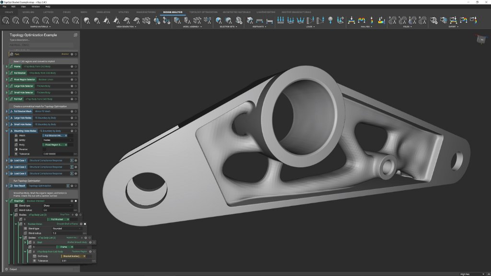
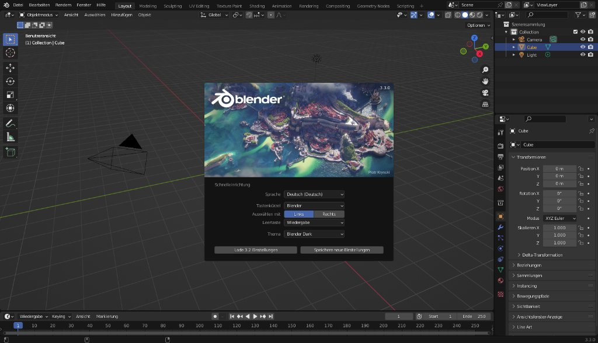
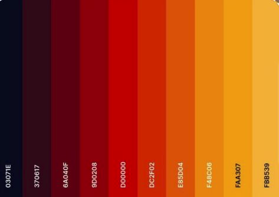
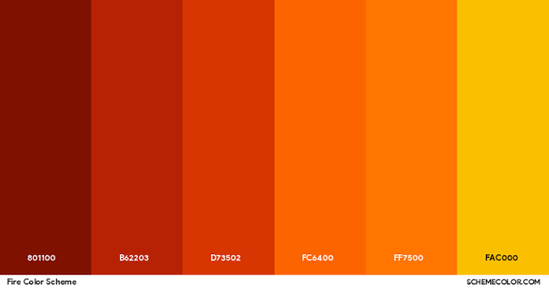
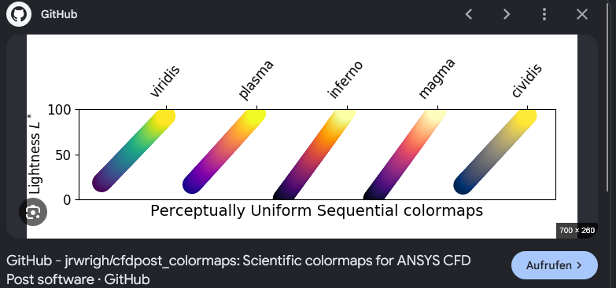
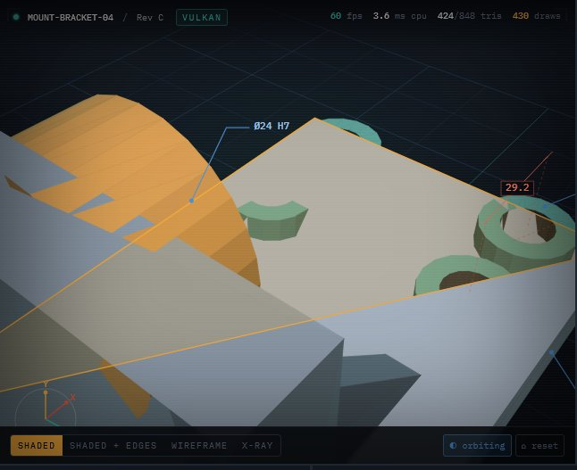
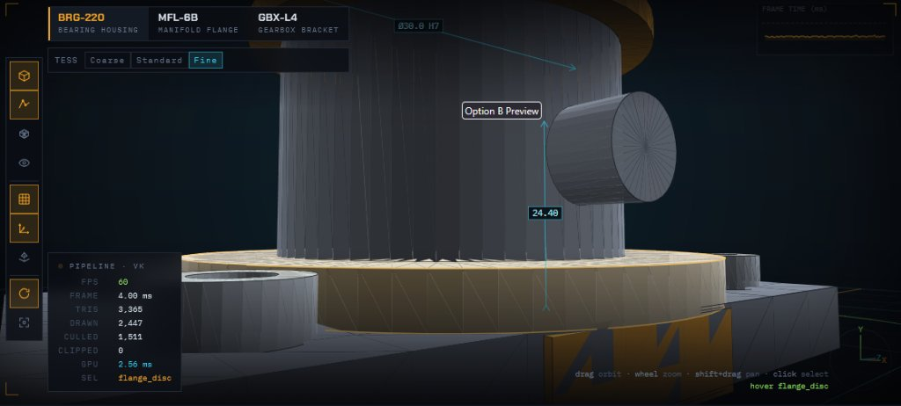

# Frontend Design- & Rendering-Referenz (Option C: Rust + `wgpu` + `egui`)

> **Zielarchitektur:** Natives High-Performance Desktop-Cockpit in **Rust** auf Basis von **`wgpu` (DirectX 12 / Vulkan)** und GPU-beschleunigter Immediate/Retained-UI (**`egui`** / modulares Plugin-System, optional OpenXR).  
> **Design-Leitbilder:** **nTop (nTopology)** (modularer Block-Stack, rahmenloser Viewport, einheitenbewusste Inputs) & **Blender** (schnelle Workspace-Tabs, 0 % Idle-Last, Outliner + kompakter Property-Inspector).

---

## 1. Visuelle UI-Leitbilder (Referenz-Screenshots)

### 1.1 nTop — Block-basierter Engineering-Workflow & CAD/Mesh-Ästhetik

**Übernommene Kernkonzepte aus nTop:**
* **Maximaler Viewport-Anteil (> 80 %):** Keine verschwendeten Fensterränder; die 3D-Geometrie steht im Zentrum.
* **Farbcodierter Notebook-/Block-Stack (links):** Jedes Physik-Modul, jede Vernetzungsregel und jede Randbedingung ist eine aufklappbare Karte mit Farbstreifen (Kategorie), Status-Icon, Sichtbarkeits-Auge und typisierten Inline-Inputs.
* **Kontext-Ribbon mit klaren Kategorien (oben):** Schneller Wechsel der Arbeitsphase (*CAD / Prep*, *Meshing*, *Physics & Chemistry*, *Solve*, *Post-Processing*).
* **Plastisches MatCap- & Cavity-Shading:** Bauteile wirken ohne manuelles Licht-Setup sofort räumlich lesbar.

### 1.2 Blender — GPU-gezeichnete Dark-UI & Workspace-Ergonomie

**Übernommene Kernkonzepte aus Blender:**
* **Workspace-Tabs in der Top-Bar:** Ein-Klick-Umschaltung kompletter Fenster-Layouts (z. B. *Setup*, *Mesh Inspection*, *Live Residuals*, *Multi-Slice Post*, *XR View*).
* **Szenen-Outliner (oben rechts) + Property-Inspector (unten rechts):** Saubere Trennung zwischen Geometrie-/Patch-Hierarchie (`boundary`: `inlet`, `outlet`, `bladeWall`) und detaillierten numerischen Parametern.
* **Schwebende Viewport-Gizmos & Tool-Shelf:** 3D-Achsenkreuz oben rechts (Klick auf X/Y/Z richtet Kamera orthogonal aus) und kompakte Schnitt-/Messwerkzeuge am linken Viewport-Rand.
* **Zeitleiste unten (Transient CFD):** Perfekt für instationäre OpenFOAM-Zeitschritte, Partikel-Animationen (DPM) und Wandfilm-Entwicklung.

---

## 2. UI-Farbpaletten & Akzent-Triaden

> **Goldene Regel ("Zero Color Interference"):**  
> Das **UI-Chassis** rund um den 3D-Viewport bleibt streng dunkel und neutral (Paletten **T3** & **T4** als Basis-Canvas), damit das menschliche Auge beim Ablesen der wissenschaftlichen Falschfarben im 3D-Viewport keinerlei Simultankontrast-Täuschung unterliegt. Die kräftigen Akzentfarben dienen gezielt zur **Semantik-Codierung der Physik-Blöcke**, aktiver Werkzeuge, Graphenlinien und Warnungen.

### 2.1 Übersicht der definierten Farb-Triaden

| ID | Name / Charakter | Farbe 1 | Farbe 2 | Farbe 3 | Geplanter Einsatz im Cockpit |
| :--- | :--- | :--- | :--- | :--- | :--- |
| **T1** | **Warm Editorial / Contrast** | `#F0E5DB` *(Warm Cream)* | `#474326` *(Dark Olive)* | `#FC75B4` *(Vibrant Pink)* | Kontrast-Akzent für Sonden-Marker (Probes), Schnittlinien im 2D-Plot & Export-/Report-Theme (Light Paper Mode) |
| **T2** | **Electric Precision** | `#FAC7E1` *(Soft Pink)* | `#A5467C` *(Deep Mauve)* | `#004AFD` *(Electric Blue)* | **CAD- & Geometrie-Selektion** (`#004AFD` für aktive Patches/Kanten), Spezies-/Chemie-Block-Codierung (`#A5467C`) |
| **T3** | **Obsidian Alert (Core Dark UI)** | `#111217`* *(Deep Obsidian)* | `#DFE5EB` *(Cool Ice Grey)* | `#EF233C` *(Crimson Red)* | **Primäres Dark-Theme #1:** Haupthintergrund (`#111217`), gestochen scharfe Primärtypografie (`#DFE5EB`), Divergenz-/Fehler-Stopp (`#EF233C`) |
| **T4** | **Carbon Cyber (nTop Dark UI)** | `#18181C` *(Carbon Dark)* | `#723BFA` *(Electric Violet)* | `#B9F500` *(Acid Lime)* | **Primäres Dark-Theme #2:** Panel-Cards (`#18181C`), Solver-/MHD-Kategorie (`#723BFA`), **Mesh-Qualitäts-Highlight / Konvergenz-OK / NaN-Detektor** (`#B9F500`) |
| **T5** | **Thermal Gold** | `#FDEFD6` *(Warm Ivory)* | `#731328` *(Deep Burgundy)* | `#FEC40B` *(Amber Gold)* | **Thermik-, Strahlungs- & Energie-Blöcke**, numerische Stabilitäts-Warnungen (`#FEC40B`, z. B. $Co > 1$) |
| **T6** | **High-Energy Rose & Sun** | `#6D0317` *(Dark Crimson)* | `#E52150` *(Rose Red)* | `#F4EB06` *(Sunshine Yellow)* | **Verbrennungs-, Ablations- & Batterie-Runaway-Indikatoren**, Hochlast-Kurven im Live-Residuen-Monitor |

*\*Hinweis: `#11217` wurde als regulärer 6-stelliger Hex-Wert `#111217` (RGB `17, 18, 23`) normiert.*

### 2.2 Vorgeschlagene Block-Kategorie-Farben (nTop-Style Seitenleiste)
Damit man im linken Baum sofort erkennt, welche Physik aktiv ist:
* **CAD & Domain:** `#004AFD` *(Electric Blue)*
* **Meshing & Boundary Layers:** `#B9F500` *(Acid Lime)*
* **Flow, Viscous & Multiphase:** `#DFE5EB` / Cyan-Blau
* **Energy, Radiation & Battery:** `#FEC40B` *(Amber Gold)* / `#E52150` *(Rose Red)*
* **Species, Catalysis & Ablation:** `#FC75B4` *(Vibrant Pink)* / `#A5467C` *(Deep Mauve)*
* **MHD, Acoustics & Solver Numerics:** `#723BFA` *(Electric Violet)*

---

## 3. Wissenschaftliche CFD-Colormaps (3D-Viewport & 2D-Konturen)

Alle Colormaps werden in `wgpu` als **1D-Lookup-Texturen (256–1024 Stützstellen, interpoliert im wahrnehmungstreuen CIELAB/Oklab-Raum)** hinterlegt und lassen sich per Schalter sowohl **kontinuierlich** als auch **diskret gebändert** (z. B. 10, 16, 20 Iso-Stufen wie in Ansys CFD-Post) darstellen.

### 3.1 Gesetzte Pflicht-Colormaps (Kern-Set)

| Colormap | Typ | Farbverlauf / Charakteristik | Primärer CFD-Einsatzbereich |
| :--- | :--- | :--- | :--- |
| **1. Inferno** | Sequenziell *(Perceptually Uniform)* | Tiefschwarz $\rightarrow$ Violett $\rightarrow$ Feuerrot $\rightarrow$ Gelbweiß (monoton steigende Helligkeit $L^*$) | Temperatur $T$, Enthalpie $h$, Wärmestromdichte $\dot{q}_w$, Strahlungsintensität |
| **2. Ampel (Traffic Light)** | Semantisch / Schwellenwert | Smaragdgrün $\rightarrow$ Amber Gold (`#FEC40B`) $\rightarrow$ Crimson (`#EF233C`) *(helligkeitsoptimiert gegen Rot-Grün-Blindheit)* | **Gitterqualität** ($y^+$-Zielbereich, Skewness, Non-Orthogonality), Sicherheitsfaktor, Batterie-Zelltemperatur-Limits |
| **3. Aero** | Sequenziell / Divergierend | Tief-Marineblau $\rightarrow$ Eis-Cyan $\rightarrow$ Reinweiß $\rightarrow$ Warm-Orange $\rightarrow$ Karminrot | Aerodynamik: Mach-Zahl $Ma$, Druckbeiwert $c_p$, Geschwindigkeitsbetrag $\|\mathbf{U}\|$, Totaldruckverlust |
| **4. Grün – Weiß** | Sequenziell *(Monochromatisch)* | Dunkel-Waldgrün $\rightarrow$ Smaragd $\rightarrow$ Mint $\rightarrow$ Reinweiß (bzw. invertierbar Weiß $\rightarrow$ Grün) | Spezies-Massenanteile (`H2`, `CH4`, `CO`), Wandfilmdicke (`filmHeight`), Porosität, katalytische Umsatzrate |
| **5. Dark Ember (10-Step)** | Sequenziell / Diskret *(Referenzbild 1)* | `#03071E` $\rightarrow$ `#370617` $\rightarrow$ `#6A040F` $\rightarrow$ `#9D0208` $\rightarrow$ `#D00000` $\rightarrow$ `#DC2F02` $\rightarrow$ `#E85D04` $\rightarrow$ `#F48C06` $\rightarrow$ `#FAA307` $\rightarrow$ `#FBB539` | Hochtemperatur-Gasturbinenschaufeln (CHT), Ablations-Wärmelasten, glühende Festkörperzonen |
| **6. Fire Scheme (6-Step)** | Sequenziell *(Referenzbild 2)* | `#801100` $\rightarrow$ `#B62203` $\rightarrow$ `#D73502` $\rightarrow$ `#FC6400` $\rightarrow$ `#FF7500` $\rightarrow$ `#FAC000` | Verbrennungszonen, Exothermie-Quellterme, Thermal-Runaway-Hotspots |

#### Visuelle Referenzen der hinterlegten Paletten:
* **Dark Ember (10-stufig):**  
  
* **Fire Color Scheme (6-stufig):**  
  
* **Perceptually Uniform Sequential Maps ($L^*$-Linearität):**  
  

---

### 3.2 Externe Referenz-Bibliotheken (Standard-Integration)
1. **ANSYS CFD-Post Scientific Colormaps:**  
   * Quelle: https://github.com/jrwrigh/cfdpost_colormaps/tree/master/colormaps  
   * Enthält u. a.: `viridis`, `plasma`, `inferno`, `magma`, `cividis` (monoton steigende Helligkeit $L^*$, druck- und graustufenecht).
2. **Kenneth Moreland — Scientific Color Advice:**  
   * Quelle: https://www.kennethmoreland.com/color-advice/  
   * Enthält die mathematischen Grundlagen gegen Regenbogen-Artefakte sowie Referenztabellen für:
     * **Cool-Warm (Smooth Diverging)**
     * **Black-Body Radiation** & **Extended Kindlmann**
     * **Fast** (optimiert für schnelle Strömungsübersichten)

---

### 3.3 Empfohlene Ergänzungen für den CFD-Praxiseinsatz

Damit uns in keinem der 12 Physik-Module ein Spezialwerkzeug fehlt, ergänzen wir das Colormap-System um folgende 5 Profi-Features:

1. **Moreland Cool-Warm (Diverging mit hartem Nullpunkt):**
   * Unverzichtbar für vorzeichenbehaftete Größen wie Relativdruck $p - p_\infty$, axiale Rückströmung ($U_x < 0$ = Ablöseblase!), Wandwärmestrom (Heizen vs. Kühlen) oder Wirbelstärke $\omega_z$. Die neutrale Mitte liegt exakt auf $0$.
2. **Turbo (Artefaktfreier Modern-Rainbow):**
   * Viele CFD-Ingenieure wünschen sich aus Ansys-/Star-CCM+-Gewohnheit einen klassischen Blau-Cyan-Grün-Gelb-Rot-Verlauf. Googles *Turbo*-Map liefert genau dieses vertraute Bild, vermeidet aber die künstlichen Helligkeitskanten des veralteten *Jet*-Verlaufs.
3. **Schlieren / X-Ray Greyscale:**
   * Hochkontrast-Graustufenskala speziell für Dichtegradienten $\|\nabla \rho\|$ (Verdichtungsstöße), numerische Schlierenbilder und $Q$-Kriterium-Wirbelstrukturen.
4. **Zyklische Phasen-Map (`Twilight`):**
   * Nahtloser Übergang von $0^\circ \rightarrow 360^\circ$ (Anfangsfarbe = Endfarbe) für Umfangswinkel in Turbomaschinen, Akustik-Phasenlagen (FWH) und Magnetfeld-Orientierungen (MHD).
5. **Dedizierte Out-of-Range- & `NaN`-Signalfarben an der Legende:**
   * Klemmt der Nutzer den Anzeigebereich manuell auf z. B. $[300\,\text{K}, 900\,\text{K}]$, werden Werte $< 300\,\text{K}$ und $> 900\,\text{K}$ optional mit eigenen Clipping-Farben markiert.
   * **Killer-Feature fürs Debugging:** Zellen mit `NaN` oder `Inf` leuchten im 3D-Netz automatisch in **Acid Lime (`#B9F500`)** oder **Neon-Pink (`#FC75B4`)** auf – so sieht man divergierende Gitterzellen in Bruchteilen einer Sekunde.

---

## 4. Technische Leitplanken für Option C (Rust + `wgpu` DX12/Vulkan)

Worauf wir bei der Implementierung von Tag 1 an achten müssen:

1. **Strikte Farbraum-Trennung (Unlit Scientific Mode vs. PBR/MatCap CAD Mode):**
   * **Im CAD- & Gitter-Modus:** *MatCap-Shading* + *Screen-Space Cavity / Eye-Dome Lighting (EDL)* (wie in nTop & Blender) für plastische Tiefenwirkung ohne manuelles Lampen-Setup.
   * **Im CFD-Ergebnis-Modus:** **Kein Tone-Mapping (kein ACES/Bloom!)** auf Skalarfeldern! Ein Pixel mit $850\,\text{K}$ auf dem Bauteil muss bitgenau denselben sRGB-Farbwert besitzen wie der Punkt $850\,\text{K}$ auf dem Legenden-Farbbalken. Dezente Geometrie-Konturen kommen ausschließlich über Kanten-/Silhouetten-Shading (Fresnel/Normal-Edge), ohne den Farbton zu verfälschen.
2. **Camera-Relative Rendering (`f64` auf CPU $\rightarrow$ `f32` relativ zur Kamera auf GPU) + Reverse-Z:**
   * OpenFOAM speichert Punkte in `double` (`f64`), GPUs rendern schnell in `f32`. Indem wir vor dem Upload bzw. im Uniform-Setup relativ zur Kameraposition rechnen und einen **Reverse-Z Tiefenpuffer (`Depth32Float`)** nutzen, verhindern wir jegliches Z-Fighting – selbst wenn man bei einem $5\,\text{m}$ Bauteil auf eine $1\,\mu\text{m}$ dünne Prismenschicht ($y^+ \approx 1$) hineinzoomt.
3. **0 % GPU-Last im Stillstand (Reactive / Event-Driven Loop):**
   * Anders als Game Engines schläft unsere Render-Schleife (`ControlFlow::Wait`), solange weder Kamera bewegt, ein UI-Slider gezogen noch ein neuer OpenFOAM-Zeitschritt empfangen wird. Sobald Interaktion stattfindet, läuft das Fenster mit vollen 120–144 FPS.
4. **Typografie mit Tabular Figures & Einheiten-Intelligenz:**
   * UI-Text in klarer Sans-Serif (z. B. *Inter* / *IBM Plex Sans*), aber **alle Zahlenwerte, Exponenten, Residuen und Koordinaten zwingend mit Tabular Figures / Monospace** (*JetBrains Mono* / *IBM Plex Mono*), damit Live-Zähler niemals horizontal zittern.
   * **nTop-Style Input-Parser:** Eingabefelder akzeptieren Ausdrücke und Einheiten direkt (`15 mm`, `800 C`, `2.5 bar`, `5*pi`) und konvertieren intern verlustfrei in SI-Einheiten für OpenFOAM.
5. **Modulare XR-/CAD-Erweiterbarkeit:**
   * Saubere Kapselung des `wgpu`-Rendergraphen, sodass später ein `OpenXR`-Swapchain-Target für VR/AR-Begehungen von Bauteilen und Strömungsfeldern ohne Umbau der Datenstrukturen eingehängt werden kann.

---

## 5. Quantitative Farbmetrik-, Shader- & UX-Präzisierungen (aus Audit & `Fable52xhighCockpit`-Referenz)

Aus der mathematischen Überprüfung der Paletten (CIE $L^*$, Oklab $\Delta E$, WCAG-Kontrast und Farbsehschwächen-Simulation nach Machado et al. 2009 in `resources/reference_spickzettel/LMArena/Frontend/Fable52xhighCockpit`) gelten folgende verbindliche Präzisierungen:

1. **Original-Tabellen vs. Oklab-Baking:**
   * Veröffentlichte wissenschaftliche Referenztabellen (`Inferno`, `Viridis`, `Plasma`, `Cividis` sowie Morelands `Smooth Cool Warm`, `Bent Cool Warm`, `Fast`, `Black Body`, `Extended Black Body`, `Kindlmann`, `Extended Kindlmann`) werden aus ihren **Original-Stützstellen** übernommen.
   * Eigen- und Stützstellen-Skalen (*Ampel*, *Aero*, *Grün–Weiß*, *Dark Ember*, *Fire*) werden im Oklab-Raum auf 256 sRGB-Texel gebacken; *Gegenfarben* (wie Grün `#009E73` und Rot `#EF233C` in der *Ampel*) benötigen zwingend eine explizite Zwischenstützstelle (Amber `#FEC40B`), da jede direkte Verbindungsgerade in Oklab durch das ungesättigte Grau-Zentrum (nur 24 % Rest-Chroma) läuft.
2. **Ehrliche Einordnung von *Turbo* und *Ampel*:**
   * **Turbo** ist glatt, aber **nicht $L^*$-monoton** (Helligkeitsgipfel in der Mitte, nicht graustufenecht). Der Inspector zeigt bei Wahl einer Regenbogen-Skala einen entsprechenden Hinweis an.
   * **Ampel nur gebändert und mit Symbolik:** Da Grün (`#009E73`, $L^* \approx 58$) und Signal Red (`#EF233C`, $L^* \approx 52$) nahezu gleich hell sind, während Gelb (`#FEC40B`, $L^* \approx 83$) hell heraussticht, wird die Ampel im CFD mit **diskreten Iso-Bändern und festen `checkMesh`-Schwellwerten** (z. B. Non-Orthogonality $70^\circ$, Skewness $4$) eingesetzt.
3. **Automatische kollisionsfreie `NaN`-Signalfarben-Wahl (`pickSignal`):**
   * Eine starre Signalfarbe kollidiert je nach gewählter Colormap (Acid Lime `#B9F500` liegt nahe an den Grüntönen von *Viridis*; Vibrant Pink `#FC75B4` nahe an *Plasma/Inferno*).
   * **Regel:** Der Loader berechnet für jede Colormap den minimalen Oklab-Abstand $\Delta E$ zu `#FC75B4` und `#B9F500` und wählt automatisch den Kandidaten mit dem **größten Abstand $\Delta E$** zur gesamten LUT (*Vibrant Pink* gewinnt bei 10 von 17 Maps, *Acid Lime* bei 7 von 17 Maps).
4. **Diagonale Shader-Schraffur für Bereichsüberschreitungen (Out-of-Range Hatching):**
   * Werte außerhalb von $[\text{Min}, \text{Max}]$ werden im Fragment-Shader optional mit einer **bildschirmfesten diagonalen Schraffur** überlagert (`fract((fragCoord.x + fragCoord.y) / (10.0 * px))`). Ein Muster bleibt mit *jeder* Colormap und bei *jeder* Farbsehschwäche eindeutig erkennbar.
5. **Verwechslungsschutz & Oklab-`textTint()` im dunklen UI-Chassis:**
   * **Signal Red (`#EF233C`) vs. Rose Red (`#E52150`):** Farbabstand nur $\Delta E = 5{,}9$ (praktisch derselbe Ton). Fehlerzustände und Verbrennungs-Blöcke dürfen nie allein über den Rotton unterschieden werden, sondern tragen immer **Icon + Text**.
   * **Electric Blue (`#004AFD`) vs. Electric Violet (`#723BFA`):** Fallen unter Protanopie auf $\Delta E = 4{,}8$ zusammen $\rightarrow$ jeder Block im Block-Stack erhält ein eigenes Kategorie-Icon; die Basis-Strömung bleibt akzentfrei (`#DFE5EB` Cloud).
   * **Schrift-Aufhellung (`textTint`):** `#004AFD` (Kontrast `2.3 : 1` auf `#171920`), `#723BFA` (`3.3 : 1`) und `#A5467C` (`3.1 : 1`) sind für den 4px-Blockstreifen ideal, als Text/Icon auf dunklem Grund aber zu dunkel. Für Labels/Icons werden sie in Oklab bei konstantem Farbton auf einen Zielkontrast von $\ge 4{,}5 : 1$ aufgehellt.
6. **Zelldaten flach (`Flat`), Knotendaten interpoliert & Verbot von Alpha-Transparenz auf Skalarflächen:**
   * Zellqualitäts-Felder und `NaN`-Markierungen gehören zur Zelle und müssen im Rust-Renderer **flach pro Zelle (ohne Vertex-Interpolation)** gezeichnet werden, damit einzelne schlechte Zellen nicht zwischen intakten Nachbarn verschwinden.
   * Auf aktiven Skalarflächen wird **keine Alpha-Transparenz** verwendet, da Alpha-Blending Mischfarben erzeugt, die nicht auf der Legende existieren (stattdessen: Schnittebene, Ausblenden oder Silhouetten-Drahtgitter).
7. **Feste Wertebereiche, symmetrischer Null-Lock (`zeroLock`) & eingebettete Legende:**
   * Bei divergenten Maps (*Smooth Cool Warm*, *Fast*) auf vorzeichenbehafteten Größen ($c_p$, $p - p_\infty$, $U_x$) hält ein `zeroLock`-Schalter $[\text{Min}, \text{Max}]$ automatisch symmetrisch um $0$.
   * Jeder Screenshot-/Bildexport bettet Feldname, Einheit, Zahlenbereich, Colormap und Zeitschritt direkt ins Bild ein.
8. **Offene Bestätigungspunkte durch den User:**
   * `#11217` $\rightarrow$ normiert als `#111217` (*Deep Obsidian*) – bitte kurz bestätigen.
   * **Aero-Colormap:** Aktuell als *Nachtblau (`#050B2E`) $\rightarrow$ Electric Blue (`#004AFD`) $\rightarrow$ Cloud (`#DFE5EB`)* definiert (oder alternativ klassisch divergierend Blau–Weiß–Rot) – bitte gewünschte Variante bestätigen.

---

## 6. Auswertung & Lehren aus `Qwen38maxCADRender1/2` (und Duplikat `AgentModeModelUnknownRender`) — Keine 1:1-Übernahme!

> **Wichtiger Befund:** `Qwen38maxCADRender1` und `AgentModeModelUnknownRender` sind **Bit für Bit identisch** (SHA-256-geprüft). Beide Qwen-Entwürfe enthalten wertvolle Einzelmodule und UI/HUD-Ideen, dürfen aber **nicht 1:1 übernommen** werden, da ihre Geometrie-Tessellierung und Schnitt-Darstellung sichtbare Artefakte aufweisen.

### Visuelle Referenz der Qwen-Prototypen (Positiv-Ideen vs. Rendering-Mängel)

| Screenshot 1: Schnittebene & 3D-Bemaßungs-Callouts (`Qwen38maxCADRender2`) | Screenshot 2: Tessellierungs- & Naht-Artefakte (`Qwen38maxCADRender`) |
| :---: | :---: |
|  |  |
| **Gut (Übernehmen):** Dezente 3D-Bemaßungs-Leader (`Ø24 H7`, `29.2`), kompaktes Viewport-HUD (`60 fps · 3.6 ms cpu · tris · draws`), Untere Schnell-Umschaltleiste (`SHADED`, `SHADED + EDGES`, `WIREFRAME`, `X-RAY`). **Schlecht (Vermeiden):** Flache, halbtransparente Schnittebene ohne echten Tiefenpuffer/Stencil-Cap (sieht hohl und überlappend aus). | **Gut (Übernehmen):** Umschaltbare Tessellierungs-Auflösung (`Coarse | Standard | Fine`), kompaktes Pipeline-Telemetrie-Overlay (`FPS`, `FRAME`, `TRIS`, `DRAWN`, `CULLED`, `GPU`), vertikale Schnell-Toolbar links. **Schlecht (Vermeiden):** Deutliche **Sägezahn-/Z-Fighting-Artefakte** an der unterenZylinder-Flansch-Naht, facettierte Zylinder-Normalen ohne glatte Phong/B-Rep-Normalen und unsaubere Triangulationsfächer am Zylinderdeckel. |

### A. Was wir gezielt als Baustein adaptieren (Rosinenpicken)

1. **Aus `Qwen38maxCADRender1` (`crates/cad_renderer`, `cad_core`, `cad_plugin_api`, `cad_addons`):**
   * **Endloses Reverse-Z CAD-Grid (`cad_grid.wgsl`):** Fullscreen-Ray-Plane-Intersection mit `fwidth()`-Filterung, Major/Minor-Teilungen, X/Z-Achsenlinien und Grazing-Angle-Fade gegen Horizontflimmern.
   * **Topologische Kanten-Extraktion & Wasserdichtigkeits-Prüfung (`mesh.rs` + `cad_edges.wgsl`):**
     * Trennung zwischen scharfen Konstruktionskanten (`EdgeKind::Crease` über Dihedralwinkel) und offenen Bauteilrändern (`EdgeKind::Boundary`, Kanten mit nur 1 angrenzenden Dreieck).
     * **CFD-Geometry-Doctor:** Offene Randkanten (`Boundary`) werden im Viewport sofort warnend hervorgehoben, damit der Nutzer vor dem Vernetzen sieht, wo eine STL/STEP-Geometrie nicht wasserdicht ist.
   * **GPU-basiertes 1-Pixel-Picking (`cad_pick.wgsl`):** `R32Uint`-Offscreen-Pass für verzögerungsfreie Patch- und Bauteil-Auswahl per Mausklick/Hover unter Beachtung aktiver Schnittebenen.
   * **Oberflächen-Diagnose-Modi (`cad_surface.wgsl`):** Prozedurales *MatCap/Curvature*, *Gooch-Shading* (technische Zeichnung), *Zebra-Streifen* (Krümmungsstetigkeit) und *Backface-Cross-Hatching* bei aufgeschnittenen Hohlkörpern.
   * **Zweistufiges Addon-Konzept (`bevy_ecs` + `Rhai`-Scripting):** Saubere Trennung zwischen kompilierten Rust-ECS-Plugins und leichtgewichtigen `Rhai`-Skripten für parametrische Geometrie-Generatoren oder Prüfwerkzeuge.
2. **Aus `Qwen38maxCADRender2` (UI/HUD & Architektur):**
   * **3D-PMI-/Mess-Callouts im Viewport:** Abgeknickte Maßhilfslinien (`Ø24 H7`, Abstände, Winkel) als scharfe Screen-Space-Overlays.
   * **Tessellierungs-Stufen (`Coarse / Standard / Fine`) & Frame-Budget-Telemetrie:** Kompakte Anzeige von CPU-/GPU-Framezeit sowie gezieltes Frustum-Culling.

### B. Was wir an `Qwen38maxCADRender1/2` zwingend korrigieren / nicht übernehmen

1. **Keine facettierten Zylinder-Nähte oder Sägezahn-Artefakte:**
   * Die prozeduralen Primitiven in `Qwen38maxCADRender1/2` teilen sich an Übergängen keine sauber verschmolzenen Topologiekanten und nutzen teils Flat-Normals pro Dreieck. Unser Renderer trennt **glatte analytische/interpolierte Vertex-Normalen** (für glatte Oberflächen) strikt vom **separaten Kanten-Indexbuffer (`EdgeVertex`)** für scharfe Feature-Kanten.
2. **Echte geschlossene Schnittebenen (Capped Section Cuts) statt hohler 2D-Schnitte:**
   * Statt einer bloß drübergelegten orangen Ebene wie in Screenshot 1 erzeugen wir bei massiven CAD-Körpern eine echte **Schnittflächen-Füllung (Stencil-Cap bzw. Sutherland-Hodgman Cap-Polygon mit Schraffur)** plus scharfer Schnittkonturkante (`cap_edges`).
3. **Korrektur der halluzinierten `Cargo.toml`-Versionsnummern:**
   * `Qwen38maxCADRender1` listet nicht-existierende Crate-Versionen (`wgpu = "30.0.1"`, `egui = "0.37.0"`, `bevy_ecs = "0.20.1"`). Beim Projekt-Setup pinnen wir ausschließlich reale, verifizierte crates.io-Releases.
4. **Kein ACES-Tonemapping auf CFD-Skalarfeldern:**
   * `cad_surface.wgsl` wendet pauschal `aces_tonemap()` an. Das darf **nur** im CAD-Studio-Modus aktiv sein; unser CFD-Modus (`Unlit Scientific`) umgeht Tonemapping komplett.
5. **Reaktiver Event-Loop statt Dauer-Redraw:**
   * `app.rs` in `Qwen38maxCADRender1` feuert in `about_to_wait` ununterbrochen `window.request_redraw()`. Wir erzwingen wie in Abschnitt 4.3 definiert `ControlFlow::Wait` (0 % GPU-Last im Idle).
